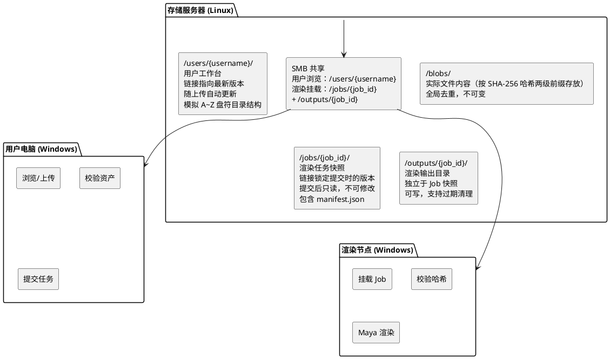
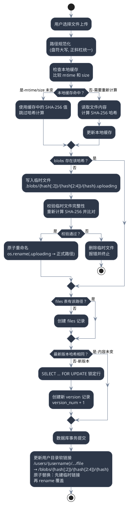
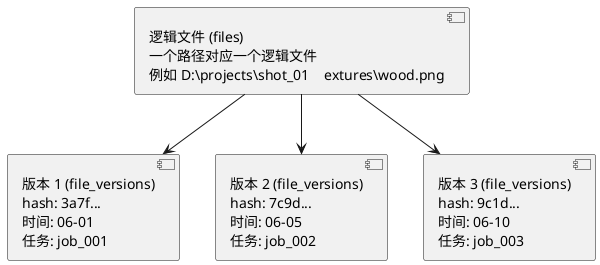
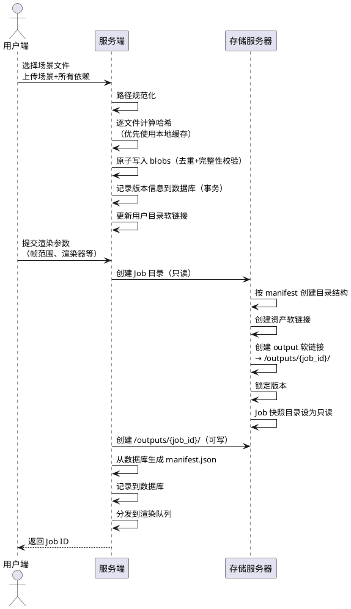
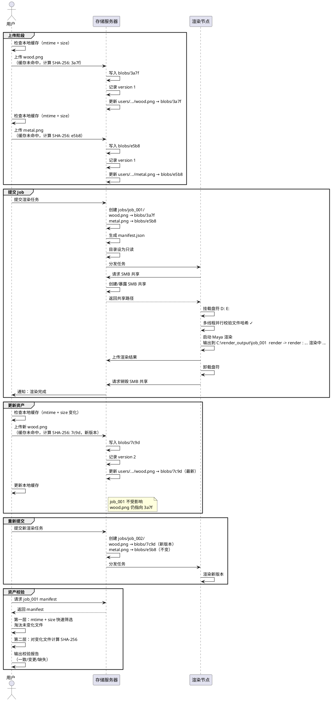

# 渲染农场文件管理系统 — 用户资产存储设计文档

> 文档版本：v4.4
> 创建日期：2025-06-10
> 最后更新：2026-06-02
> 状态：设计阶段
> 
> **变更历史**：详见 [CHANGELOG.md](./CHANGELOG.md) 和 [revision-history.md](./revision-history.md)
> 
> **最新变更（v4.4）**：
> 
> - **[改进]** 缓存验证增加 1% 抽样机制，检测 mtime+size 碰撞或缓存损坏（6.2 节）
> - **[优化]** SMB 文件校验增加并发限流（Semaphore）和按大小排序优化（9.4 节）
> 
> **历史变更**：详见 [CHANGELOG.md](./CHANGELOG.md)

---

## 目录

1. [系统概述](#1-系统概述)
2. [核心设计理念](#2-核心设计理念)
3. [系统架构总览](#3-系统架构总览)
4. [存储层设计](#4-存储层设计)
   - 4.1 通用工具函数
   - 4.2 Blobs 存储（内容寻址）
   - 4.3 用户目录（当前工作状态）
   - 4.4 Job 目录（渲染快照）
   - 4.5 监控与告警工具
5. [数据库设计](#5-数据库设计)
6. [文件上传流程](#6-文件上传流程)
7. [版本管理机制](#7-版本管理机制)
   - 7.1 版本数据模型
   - 7.2 版本记录逻辑
   - 7.3 引用计数与删除策略
   - 7.4 文件生命周期管理
8. [Job 提交与版本锁定](#8-job-提交与版本锁定)
9. [渲染节点执行流程](#9-渲染节点执行流程)
   - 9.1 设计原则
   - 9.2 Agent 主流程
   - 9.3 SMB 盘符映射
   - 9.4 文件校验
   - 9.5 Maya 渲染启动
   - 9.6 输出上传
   - 9.7 任务结束与清理
10. [本地资产校验工具](#10-本地资产校验工具)
11. [Samba 共享配置](#11-samba-共享配置)
12. [特殊场景处理](#12-特殊场景处理)
    - 12.1 大文件处理
    - 12.2 渲染节点存储设计
    - 12.3 哈希计算性能优化
    - 12.4 临时文件清理
    - 12.5 渲染任务超时与僵尸任务处理
    - 12.6 渲染节点状态检查
    - 12.7 存储空间监控
    - 12.8 Maya 场景复杂依赖
    - 12.9 哈希碰撞防护
13. [技术选型建议](#13-技术选型建议)
14. [安全性设计](#14-安全性设计)

---

## 1. 系统概述

本系统是一个面向影视/动画制作的渲染农场文件管理系统，核心目标是：

- **统一管理**：用户将 Maya 场景文件及其所有依赖资产（贴图、HDRI、引用文件等）统一上传至云端存储
- **版本追踪**：自动记录每个文件的每次变更，形成完整的版本历史
- **快照锁定**：每次提交渲染任务时，锁定该时刻所有文件的版本，确保渲染结果可追溯、可复现
- **去重存储**：相同内容的文件全局只存一份，不同版本、不同任务之间共享存储
- **路径还原**：渲染节点执行时，将云端存储的文件映射回用户本地的原始 Windows 路径

系统运行环境：用户端为 Windows（Maya 创作环境），存储服务器为 Linux，渲染节点为 Windows。

---

## 2. 核心设计理念

### 2.1 内容寻址存储（Content-Addressable Storage）

所有文件以 **SHA-256 哈希值** 作为唯一标识，而非文件名。

- 同一内容的文件只存一份（去重）
- 不同版本的同名文件天然共存（哈希不同）
- 文件内容不可变，写入后不可修改（immutable）
- blob 写入采用"临时文件 → 校验 → 原子重命名"三步流程，保证写入完整性

SHA-256 属于密码学安全哈希算法，为系统提供以下保证：

- 去重的正确性（不同内容几乎不可能产生相同哈希）
- 版本锁定的可靠性（任何篡改都会导致哈希变化）
- 与 PostgreSQL、MinIO/S3 等基础设施的原生兼容

### 2.2 Manifest 快照

每次提交渲染任务时生成一份 **Manifest**（清单），记录该次提交涉及的所有文件及其哈希、版本号。

- **数据库为主数据源**：所有版本信息和快照记录以 PostgreSQL 中的数据为权威
- Manifest 是不可变快照，提交后不可修改
- 渲染时严格按照 Manifest 中记录的版本执行
- 任何时候对同一 Manifest 重新渲染，结果完全一致

**manifest.json 文件**是 Job 快照的可读副本，存储在 Job 目录中供渲染节点离线参考和人工审查。当 manifest.json 与数据库不一致时，以数据库为准；manifest.json 可从数据库重建。

### 2.3 版本锁定原则

**Job 一旦提交，其文件版本就不可变。**

- 用户上传新资产不影响已提交的 Job
- 用户修改本地文件不影响已提交的 Job
- 用户手动替换服务器文件不影响已提交的 Job
- 想用新资产 → 必须重新提交新 Job

这保证了：任何人、任何时候对同一个 Job 重新渲染，结果都和第一次完全一致。

### 2.4 增量校验策略

渲染制作场景中，单个 Maya 场景可能依赖成千上万个文件（贴图、HDRI、引用文件、脚本等）。对所有文件每次全量计算 SHA-256 会导致严重的性能瓶颈。

系统采用**分层校验**策略，平衡可靠性与速度：

| 层级  | 检测方式                      | 速度               | 可靠性 | 作用            |
| --- | ------------------------- | ---------------- | --- | ------------- |
| 第一层 | 文件修改时间（mtime）+ 文件大小（size） | 极快（每文件 < 0.01ms） | 中   | 快速筛选，淘汰未变化的文件 |
| 第二层 | SHA-256 完整内容哈希            | 中等（受存储 I/O 限制）   | 最高  | 对有变化的文件做权威校验  |

工作原理：

- 系统在用户端维护一个**本地哈希缓存**，记录每个文件的 `路径 → (mtime, size, sha256)` 映射
- 校验时，先比对 mtime 和 size：若两者均未变化，直接复用缓存中的 SHA-256 值，跳过文件读取和哈希计算
- 仅对 mtime 或 size 有变化的文件，重新读取内容并计算 SHA-256
- 计算完成后更新缓存

**性能估算：** 在典型场景下（用户仅修改了少量文件），3000 个依赖文件中 99% 以上可通过第一层筛选跳过，实际需要计算 SHA-256 的文件可能仅几十个，校验时间从分钟级降至**秒级**。

### 2.5 路径规范化原则

系统跨 Windows（大小写不敏感）和 Linux（大小写敏感）运行。为保证路径一致性：

- 所有文件路径在入库前统一**规范化**：盘符大写，路径部分统一小写，路径分隔符统一为 `/`（由 `normalize_windows_path` 保证，与 PostgreSQL `normalize_path()` 行为一致）
- 数据库中存储规范化后的路径
- 存储目录结构按规范化路径创建
- Samba 配置为大小写不敏感模式，确保渲染节点通过 SMB 挂载时行为与用户本地 Windows 一致
- **已知限制**：Maya 场景内嵌的 Python/MEL 脚本可能硬编码大小写敏感的路径字符串（如 `open("D:/Textures/Wood.png")`），系统路径还原依赖 Samba 的 `case insensitive` 特性，但无法保证 Maya 内部脚本对路径字符串的直接解析。建议在客户端校验工具（第 10 节）中增加对场景内引用路径大小写不一致的预警

### 2.6 数据权威源与一致性原则

- **数据库（PostgreSQL）**是所有元数据的唯一权威源，包括文件路径、版本信息、快照清单、引用计数
- **manifest.json** 是快照的可读副本，供渲染节点离线参考，可从数据库重建
- **blobs 文件**的实际内容以哈希校验为准，写入时必须经过完整性验证

---

## 3. 系统架构总览



**部署约束：**

- **文件系统同区挂载**：`/render_storage/blobs`、`/render_storage/users`、`/render_storage/jobs`、`/render_storage/trash` 必须位于同一文件系统实例（同一挂载点），否则 `os.rename` 会抛 `EXDEV` 错误，`os.symlink` 创建的绝对路径软链接可能跨区无法解析
- **Samba 宽链接**：`smb.conf` 必须配置 `follow symlinks = yes` 和 `wide links = yes`（见第 11 节），否则 SMB 客户端无法跟随指向 blobs 目录的绝对路径软链接
- **Samba 大小写**：`case sensitive = no` 保证 Windows 渲染节点的路径行为与本地一致

---

## 4. 存储层设计

### 4.1 通用工具函数

以下路径工具函数在所有涉及 blobs 路径的模块中统一使用：

```python
import re

def normalize_windows_path(windows_path: str) -> str:
    """
    将 Windows 路径规范化为存储路径。
    规则：
    - 盘符统一转大写，去除冒号（D: → D，d: → D）
    - 路径部分统一转小写（与 PostgreSQL normalize_path 行为对齐）
    - 反斜杠统一为正斜杠
    - 去除多余分隔符
    - 支持 UNC 路径（\\server\share\...）

    盘符冒号去除的原因：存储服务器为 Linux，冒号在某些文件系统和
    NFS 配置中可能引发兼容性问题。去除后路径为 D/projects/...，
    在 Linux 用户目录下创建 D/ 子目录，与 Windows 盘符映射一致。

    路径部分转小写的原因：Windows 文件系统大小写不敏感，同一路径
    可能以不同大小写传入（D:/Projects vs D:/projects）。统一转小写
    确保 UNIQUE(user_name, path) 约束能正确去重，与 PostgreSQL
    normalize_path() 函数行为保持一致。
    """
    path = windows_path.replace("\\", "/")

    # 处理 UNC 路径（//server/share/...）
    if path.startswith("//"):
        # 保留 UNC 前缀（//server/share），路径部分转小写
        path = "//" + re.sub(r"/+", "/", path[2:])
        parts = path.split("/")
        # parts: ['', '', 'server', 'share', 'path', ...]
        if len(parts) > 4:
            unc_prefix = "/".join(parts[:4])
            remaining = "/".join(parts[4:])
            return unc_prefix + "/" + remaining.lower()
        return path

    # 本地路径：合并连续斜杠
    path = re.sub(r"/+", "/", path)

    # 盘符处理：去除冒号，盘符大写，路径部分小写
    if len(path) >= 2 and path[1] == ":":
        path = path[0].upper() + path[2:].lower()
    else:
        # 相对路径或其他格式：整体转小写（与 PostgreSQL normalize_path 的 ELSE 分支对齐）
        path = path.lower()

    return path


def get_blob_path(file_hash: str) -> str:
    """
    根据哈希值计算 blob 存储路径。
    按前两级分目录：/render_storage/blobs/3a/7f/3a7f8b2c...
    256 x 256 = 65536 个子目录，每个子目录文件数可控。
    """
    import re
    if len(file_hash) != 64:
        raise ValueError(f"Invalid SHA-256 hash length: {len(file_hash)}")
    if not re.match(r'^[0-9a-f]{64}$', file_hash):
        raise ValueError(f"Invalid SHA-256 hash format: must be lowercase hex")
    return f"/render_storage/blobs/{file_hash[:2]}/{file_hash[2:4]}/{file_hash}"


def normalize_path_for_compare(path: str) -> str:
    """
    用于路径比较和数据库查询的规范化函数。

    自 v2.2 起，normalize_windows_path 已统一将路径部分转小写，
    两者行为完全一致。此函数保留为语义别名，调用方可用此函数
    明确表达"此路径用于比较/查询"的意图。
    """
    return normalize_windows_path(path)
```

### 4.2 Blobs 存储（内容寻址）

**目录结构（按哈希前缀分两级目录）：**

```
/render_storage/blobs/
  ├── 3a/
  │   └── 7f/
  │       └── 3a7f8b2c9d0e1f2a...    ← 文件内容
  ├── e5/
  │   └── b8/
  │       └── e5b8a2d1f3c4b5a6...    ← 文件内容
  ├── 9b/
  │   └── 2c/
  │       └── 9b2c3d4e5f6a7b8c...    ← 文件内容
  └── ...
```

**存储规则：**

- 文件以完整的 SHA-256 哈希值为文件名，按前两位和三四位两级子目录存放
- **所有代码中获取 blob 路径必须调用 `get_blob_path(hash)`**，禁止手动拼接路径
- 256 x 256 = 65,536 个子目录，每个子目录下的文件数可控，文件系统操作性能稳定
- 相同内容的文件只存一份，天然去重
- 文件写入后不可修改（immutable），写入时必须经过完整性校验（见第 6 节）
- 删除需检查引用计数，无引用后方可删除

**去重原理示例：**

```
任务 A 提交：A.ma → 依赖 textures/wood.png (SHA-256: 3a7f...)
任务 B 提交：B.ma → 依赖 assets/shared/wood.png (SHA-256: 3a7f...)
                                                      ↓
                                              哈希完全相同
                                                      ↓
                                           存储里只有一份 blob
                                          路径: /blobs/3a/7f/3a7f...
```

不同任务、不同用户、不同路径，只要文件内容相同，就共享同一个 blob。

### 4.3 用户目录（当前工作状态）

**目录结构：**

```
/render_storage/users/zhangsan/
  ├── A/
  ├── B/
  ├── ...
  ├── D/
  │   └── projects/
  │       └── shot_01/
  │           ├── textures/
  │           │   ├── wood.png       → /blobs/3a/7f/7c9d...  (当前最新 v3)
  │           │   └── metal.png      → /blobs/e5/b8/e5b8...  (当前最新 v1)
  │           └── scenes/
  │               └── main.ma        → /blobs/9b/2c/9b2c...  (当前最新 v2)
  ├── E/
  ├── ...
  └── Z/
```

**设计要点：**

- 每个用户一个独立目录
- 目录下按 A~Z 盘符建立子文件夹，模拟用户本地磁盘结构
- 路径按规范化规则存储（盘符大写，路径部分统一小写，由 `normalize_windows_path` 保证）
- 所有文件均为软链接，指向 blobs 存储中的实际内容（使用 `get_blob_path()` 计算路径）
- 用户上传新文件时，链接自动更新指向最新哈希
- 用户本地删除文件时，可选策略见第 7.4 节文件生命周期管理
- 通过 SMB 共享给用户，Samba 配置为大小写不敏感模式（见第 11 节）

### 4.4 Job 目录（渲染快照）

**目录结构：**

```
/render_storage/jobs/job_001/
  ├── manifest.json                        ← 快照清单（数据库的可读副本）
  ├── D/                                   ← 盘符单字母大写（与 normalize_windows_path 输出一致）
  │   └── projects/
  │       └── shot_01/
  │           ├── textures/
  │           │   ├── wood.png             → /blobs/3a/7f/3a7f...  (锁定 v1)
  │           │   └── metal.png            → /blobs/e5/b8/e5b8...  (锁定 v1)
  │           └── scenes/
  │               └── main.ma              → /blobs/9b/2c/1122...  (锁定 v1)
  └── output/                              ← 软链接，指向 /outputs/job_001/
```

**渲染输出目录（独立于 Job 快照）：**

```
/render_storage/outputs/
  └── job_001/                             ← 可写，支持过期清理
      ├── shot_01.0001.exr
      ├── shot_01.0002.exr
      └── ...
```

**设计要点：**

- 每次提交渲染任务创建一个 Job 目录

- **Job 快照目录（`/jobs/{job_id}/`）严格只读**：软链接在创建时写入，之后不可修改
  
  - **多层只读保障**：
    
    1. 文件系统层：Job 顶级目录 `chattr +i` 浅层锁定（目录内无法增删文件），内部软链接无需额外权限控制（blob 本身为只读）
    2. Linux immutable 属性：关键目录设置 `chattr +i`，阻止任何修改（包括 root）
    3. API 层：禁止对 Job 目录的写入操作，所有修改请求返回 403
  
  - **服务身份要求**：存储服务以非 root 用户运行（如 `renderfs` 用户），避免权限绕过
  
  - **能力配置要求**：`renderfs` 用户需要 `CAP_LINUX_IMMUTABLE` 能力才能执行 `chattr +i/-i` 操作。**推荐使用 sudoers 方案**（限制路径范围，避免全局授权）：
    
    ```bash
    # 方案一（推荐）：sudoers 限制性授权，仅允许操作 /render_storage/jobs/ 目录
    # /etc/sudoers.d/renderfs-chattr
    # 浅层锁定：仅操作 Job 顶级目录 inode（非 -R 递归），目录内无法增删文件
    #
    # 安全说明：使用 [a-zA-Z0-9_-]* 限制 job_id 字符集，防止路径遍历攻击
    # （如 /render_storage/jobs/../../etc 这样的恶意路径会被拒绝）
    renderfs ALL=(root) NOPASSWD: /usr/bin/chattr +i /render_storage/jobs/[a-zA-Z0-9_-]*
    renderfs ALL=(root) NOPASSWD: /usr/bin/chattr -i /render_storage/jobs/[a-zA-Z0-9_-]*
    
    # 方案二：setcap 全局授权（不推荐，可能意外锁定非 Job 目录）
    # sudo setcap cap_linux_immutable=+ep /usr/bin/chattr
    ```
    
    代码中的 `set_immutable` 和 `clear_immutable` 函数使用 `sudo chattr` 调用，与 sudoers 方案一致。

- 链接精确指向提交时的 blob 哈希，不受后续文件更新影响

- manifest.json 从数据库生成，作为可读副本和渲染节点离线参考

- **渲染输出目录独立存放于 `/outputs/{job_id}/`**，与 Job 快照物理隔离

- Job 目录下的 `output/` 为指向 `/outputs/{job_id}/` 的软链接，渲染节点通过该链接写入输出

- 输出目录可设置独立的过期清理策略（如保留 30 天后自动归档/删除）

- Job 目录中记录输出目录路径，写入 manifest.json 元数据

**用户目录与 Job 目录的关系：**

```
用户目录：反映"当前最新状态"
  └── 上传新文件 → 链接自动更新 → 始终指向最新版本

Job 目录：锁定"提交时的状态"
  └── 创建后链接固定 → 不受任何后续上传影响 → 始终指向提交时的版本

输出目录：独立于快照，管理渲染产物的生命周期
  └── 渲染完成后写入 → 可设置过期策略 → 不影响 Job 快照的只读性
```

### 4.5 监控与告警工具

以下工具函数用于系统运行时的监控和告警，被多个模块调用：

```python
def report_alert(level: str, component: str, message: str, details: dict = None):
    """
    上报监控告警。

    参数:
        level: 告警级别，'WARNING' / 'CRITICAL'
        component: 组件名称，如 'storage' / 'smb' / 'agent'
        message: 告警消息
        details: 附加详情（可选）
    """
    import json
    from datetime import datetime

    alert = {
        "timestamp": datetime.utcnow().isoformat(),
        "level": level,
        "component": component,
        "message": message,
        "details": details or {}
    }

    # 写入审计日志（audit_log 表定义见 5.1 节）
    db.execute(
        """INSERT INTO audit_log (event_type, resource, action, details)
           VALUES (%s, %s, %s, %s)""",
        "system_alert", component, level.lower(), json.dumps(alert)
    )

    # 根据级别触发不同通知
    if level == "CRITICAL":
        # 临界告警：发送即时通知（邮件/钉钉/Slack）
        send_critical_notification(alert)
        print(f"[CRITICAL] {component}: {message}")
    else:
        # 警告：记录日志，批量汇总通知
        print(f"[WARNING] {component}: {message}")


def send_critical_notification(alert: dict):
    """
    发送临界告警通知。

    ⚠️ 部署前必须配置至少一种通知渠道，否则 CRITICAL 告警仅写入
    audit_log 表，无即时通知能力。建议配置环境变量：
    - ALERT_SMTP_HOST / ALERT_SMTP_PORT / ALERT_EMAIL_TO：邮件通知
    - DINGTALK_WEBHOOK：钉钉 Webhook
    - SLACK_WEBHOOK：Slack Incoming Webhook

    通知渠道不可用时，告警已写入 audit_log 表作为兜底，
    可通过定时任务扫描 audit_log 中的 CRITICAL 事件进行补偿通知。
    """
    import os
    import smtplib
    from email.mime.text import MIMEText

    message_text = (
        f"[{alert['level']}] {alert['component']}: {alert['message']}\n"
        f"时间: {alert['timestamp']}\n"
        f"详情: {alert.get('details', {})}"
    )

    # 方式一：邮件 SMTP（默认兜底）
    smtp_host = os.environ.get("ALERT_SMTP_HOST")
    if smtp_host:
        smtp_port = int(os.environ.get("ALERT_SMTP_PORT", "587"))
        email_from = os.environ.get("ALERT_EMAIL_FROM", "alert@renderfarm.local")
        email_to = os.environ.get("ALERT_EMAIL_TO", "admin@renderfarm.local")

        msg = MIMEText(message_text, "plain", "utf-8")
        msg["Subject"] = f"[RenderFarm CRITICAL] {alert['component']}: {alert['message'][:50]}"
        msg["From"] = email_from
        msg["To"] = email_to

        try:
            import ssl
            # 生产环境应配置 ssl_context 强制验证 SMTP 服务器证书，
            # 防止中间人攻击（MITM）。以下为最小安全配置：
            ssl_context = ssl.create_default_context()
            # 如需跳过证书验证（仅限测试环境）：
            # ssl_context.check_hostname = False
            # ssl_context.verify_mode = ssl.CERT_NONE

            with smtplib.SMTP(smtp_host, smtp_port, timeout=10) as server:
                server.starttls(context=ssl_context)
                smtp_user = os.environ.get("ALERT_SMTP_USER")
                smtp_pass = os.environ.get("ALERT_SMTP_PASS")
                if smtp_user and smtp_pass:
                    server.login(smtp_user, smtp_pass)
                server.sendmail(email_from, [email_to], msg.as_string())
            print(f"告警邮件已发送: {email_to}")
            return
        except Exception as e:
            print(f"告警邮件发送失败: {e}，尝试其他渠道...")

    # 方式二：钉钉 Webhook
    webhook_url = os.environ.get("DINGTALK_WEBHOOK")
    if webhook_url:
        try:
            import requests
            requests.post(webhook_url, json={
                "msgtype": "text",
                "text": {"content": message_text}
            }, timeout=5)
            print(f"钉钉告警已发送")
            return
        except Exception as e:
            print(f"钉钉告警发送失败: {e}，尝试其他渠道...")

    # 方式三：Slack Webhook
    slack_url = os.environ.get("SLACK_WEBHOOK")
    if slack_url:
        try:
            import requests
            requests.post(slack_url, json={
                "text": message_text
            }, timeout=5)
            print(f"Slack 告警已发送")
            return
        except Exception as e:
            print(f"Slack 告警发送失败: {e}")

    # 所有渠道均不可用，仅依赖 audit_log 兜底
    print(f"警告: 无可用通知渠道，告警仅记录在 audit_log 表中")
    print(f"  请配置 ALERT_SMTP_HOST / DINGTALK_WEBHOOK / SLACK_WEBHOOK 环境变量")
```

---

## 5. 数据库设计

> **架构定位（2026-06-14）**：本节所有表位于**控制面全局 PG** 的 `lc` schema（详见 `docs/11-rest-gateway-impl.md` §1.4 控制面/数据面分离）。存储元数据（路径、版本、Manifest 快照、引用计数）是跨机房共享的业务数据，必须全局集中。渲染产物文件本体仍在各机房 Storage（大文件不跨机房传）。
>
> **产物引用 vs 文件本体的分离**：
> - **引用（在本节 PG 表中）**：`/outputs/{job_id}/frame_001.exr` 这样的路径字符串 + facility_id + 哈希
> - **本体（在机房 Storage）**：实际的 exr/png 文件
> - 用户查询产物列表 → 打控制面 PG（引用） → 拿到路径 → 预签名 URL 从机房 Storage 拉取本体
> - 机房故障时，引用仍在（用户能看到"产物在某机房，暂时不可达"），本体随机房存活

### 5.1 表结构

```sql
-- 路径规范化辅助函数（PostgreSQL）
-- 存储路径时盘符大写 + 路径部分小写 + 正斜杠统一
-- 支持 Windows 本地路径和 UNC 路径
CREATE OR REPLACE FUNCTION normalize_path(path TEXT) RETURNS TEXT AS $$
DECLARE
    clean_path TEXT;
    prefix_len INT;
BEGIN
    -- 将反斜杠替换为正斜杠
    clean_path := REPLACE(path, '\', '/');

    -- UNC 路径优先处理（//server/share/...），避免后续正则合并破坏双斜杠前缀
    IF clean_path LIKE '//%' THEN
        -- 正则提取 //server/share/ 前缀（第 4 个斜杠之前的部分），性能优于 FOR 循环
        prefix_len := LENGTH(REGEXP_REPLACE(clean_path, '(^//[^/]+/[^/]+/).*', '\1'));

        IF prefix_len > 0 AND prefix_len < LENGTH(clean_path) THEN
            -- 返回：//server/share/ + 小写路径部分
            RETURN SUBSTRING(clean_path FROM 1 FOR prefix_len)
                   || LOWER(SUBSTRING(clean_path FROM prefix_len + 1));
        ELSE
            -- 边界情况：路径不足 4 个斜杠
            --   //server（2个斜杠）→ 整体保留
            --   //server/share（3个斜杠）→ 整体保留，不转小写
            --   //server/share/（4个斜杠）→ prefix_len = LENGTH，无剩余部分
            RETURN clean_path;
        END IF;

    ELSE
        -- 非 UNC 路径：合并连续斜杠
        clean_path := REGEXP_REPLACE(clean_path, '(/)(/+)', '\1', 'g');

        -- 处理本地路径（D:\...）
        IF LENGTH(clean_path) >= 2 AND SUBSTRING(clean_path FROM 2 FOR 1) = ':' THEN
            -- 本地路径：盘符保持大写，去除冒号，其余部分转小写
            -- D:\projects\... → D/projects/...
            RETURN UPPER(SUBSTRING(clean_path FROM 1 FOR 1))
                   || LOWER(SUBSTRING(clean_path FROM 3));
        ELSE
            -- 相对路径或其他格式：整体转小写
            RETURN LOWER(clean_path);
        END IF;
    END IF;
END;
$$ LANGUAGE plpgsql IMMUTABLE;

-- 逻辑文件表：记录所有出现过的文件路径
-- 多租户隔离：同一路径在不同用户下是不同的逻辑文件，
-- 避免版本历史混杂（用户 A 和用户 B 可能有相同的本地路径 D:/projects/...）
CREATE TABLE files (
    id          BIGSERIAL PRIMARY KEY,
    user_name   TEXT NOT NULL,        -- 文件所属用户（多租户隔离维度）
    path        TEXT NOT NULL,        -- 规范化后的完整路径
                                      -- 例如 D/projects/shot_01/textures/wood.png
                                      -- 盘符大写（无冒号），路径部分小写
    project     TEXT,                 -- 所属项目（可选，方便检索）
    status      TEXT DEFAULT 'active'
                CHECK (status IN ('active', 'orphaned', 'deleted')),
                                  -- active: 用户目录有对应软链接
                                  -- orphaned: 用户本地删除，软链接标记为孤儿
                                  -- deleted: 用户确认删除，可清理
    created_at  TIMESTAMPTZ DEFAULT NOW(),
    updated_at  TIMESTAMPTZ,          -- 状态更新时间
    UNIQUE(user_name, path)           -- 同一用户下路径唯一，不同用户可有相同路径
);

-- 文件版本表：每次上传内容不同就是新版本
CREATE TABLE file_versions (
    id            BIGSERIAL PRIMARY KEY,
    file_id       BIGINT REFERENCES files(id),
    version_num   INT NOT NULL,       -- 版本号，自增：1, 2, 3 ...
    hash          CHAR(64) NOT NULL,  -- SHA-256 哈希值
    size          BIGINT,             -- 文件大小（字节）
    uploaded_by   TEXT,               -- 上传用户
    uploaded_at   TIMESTAMPTZ DEFAULT NOW(),
    UNIQUE(file_id, version_num)
);

-- 快照表（Manifest）：每次提交任务的完整文件清单
CREATE TABLE manifests (
    id            BIGSERIAL PRIMARY KEY,
    job_id        TEXT NOT NULL,      -- 关联的渲染任务 ID
    user_name     TEXT,               -- 提交用户
    scene_path    TEXT,               -- 主场景文件路径（规范化后）
    output_path   TEXT,               -- 渲染输出目录路径
                                      -- 例如 /render_storage/outputs/{job_id}
    drives        TEXT[],             -- 涉及的盘符列表，如 ARRAY['D', 'E']
    created_at    TIMESTAMPTZ DEFAULT NOW(),
    updated_at    TIMESTAMPTZ,        -- 最后状态变更时间（用于归档超时判断）
    archived_at   TIMESTAMPTZ,        -- 归档时间（归档时设置）
    status        TEXT DEFAULT 'submitted'
                  CHECK (status IN ('submitted', 'rendering',
                                    'completed', 'failed',
                                    'archiving', 'archived', 'deleted'))
);
-- 状态说明：
--   submitted  - 已提交，等待渲染
--   rendering  - 渲染中
--   completed  - 渲染完成
--   failed     - 渲染失败
--   archiving  - 归档中（FS 操作进行中，引用计数仍保留，Cleaner 不会删除相关 blob）
--   archived   - 已归档（引用计数不再计入，快照保留）
--   deleted    - 已删除（快照和输出目录已清理）

-- 快照明细表：记录该次快照中每个文件使用的是哪个版本
CREATE TABLE manifest_entries (
    id               BIGSERIAL PRIMARY KEY,
    manifest_id      BIGINT REFERENCES manifests(id),
    file_id          BIGINT REFERENCES files(id),
    file_version_id  BIGINT REFERENCES file_versions(id),
    original_path    TEXT NOT NULL,   -- 规范化后的完整路径
    hash             CHAR(64) NOT NULL -- 冗余存储，方便查询
);

-- 文件移动/重命名别名表：追踪路径变更历史
CREATE TABLE path_aliases (
    id              BIGSERIAL PRIMARY KEY,
    user_name       TEXT NOT NULL,    -- 文件所属用户（与 files 表一致）
    old_path        TEXT NOT NULL,    -- 旧路径（规范化后）
    new_path        TEXT NOT NULL,    -- 新路径（规范化后）
    file_id         BIGINT REFERENCES files(id),  -- 关联的逻辑文件
    migrated_at     TIMESTAMPTZ DEFAULT NOW(),
    migrated_by     TEXT,
    UNIQUE(user_name, old_path, new_path)
);

-- 渲染节点心跳表：记录节点状态和任务进度
CREATE TABLE node_heartbeats (
    id          BIGSERIAL PRIMARY KEY,
    node_id     TEXT NOT NULL,        -- 渲染节点标识
    job_id      TEXT,                 -- 当前执行的任务 ID
    status      TEXT,                 -- 节点状态：idle/rendering/error
    progress    INT DEFAULT 0,        -- 任务进度百分比
    timestamp   TIMESTAMPTZ DEFAULT NOW(),
    UNIQUE(node_id)                   -- 每个节点一条记录，ON CONFLICT UPDATE
);

-- 任务失败记录表：记录任务失败原因
CREATE TABLE task_failures (
    id          BIGSERIAL PRIMARY KEY,
    job_id      TEXT NOT NULL,
    reason      TEXT,                 -- 失败原因：timeout/error/cancelled
    error_msg   TEXT,                 -- 详细错误信息
    detected_at TIMESTAMPTZ DEFAULT NOW()
);

-- 索引
-- UNIQUE(user_name, path) 已自动创建联合索引
-- ⚠️ 重要：所有查询必须传入已由 Python normalize_windows_path 预处理的路径字符串，
-- 避免在 SQL 中调用 normalize_path() 函数（否则 B-Tree 索引可能失效）。
-- API 层在查询前先完成规范化，直接传 D/projects/... 给 SQL。
-- 以下为额外的辅助索引
CREATE INDEX idx_files_user ON files(user_name);
CREATE INDEX idx_files_status ON files(status);
CREATE INDEX idx_file_versions_file_id ON file_versions(file_id);
-- 复合索引：优化 blob_ref_counts 视图中 SELECT MAX(version_num) 子查询
CREATE INDEX idx_file_versions_file_version ON file_versions(file_id, version_num DESC);
CREATE INDEX idx_file_versions_hash ON file_versions(hash);
CREATE INDEX idx_manifest_entries_manifest ON manifest_entries(manifest_id);
CREATE INDEX idx_manifest_entries_hash ON manifest_entries(hash);
CREATE INDEX idx_path_aliases_user_old ON path_aliases(user_name, old_path);
CREATE INDEX idx_path_aliases_user_new ON path_aliases(user_name, new_path);
CREATE INDEX idx_node_heartbeats_timestamp ON node_heartbeats(timestamp);
CREATE INDEX idx_task_failures_job ON task_failures(job_id);

-- 临时文件注册表（详见 12.4 节）
CREATE TABLE temp_file_registry (
    id          BIGSERIAL PRIMARY KEY,
    file_path   TEXT NOT NULL,        -- 临时文件完整路径
    file_type   TEXT NOT NULL         -- 'uploading'（blob 写入中的临时文件）
                CHECK (file_type = 'uploading'),
    created_at  TIMESTAMPTZ DEFAULT NOW(),
    UNIQUE(file_path)
);

CREATE INDEX idx_temp_file_registry_created ON temp_file_registry(created_at);

-- 审计日志表（基础定义，详见 14.6 节的 Range 分区表 DDL）
-- ⚠️ 生产环境请务必使用 14.6 节的分区表 DDL 替代此基础定义，否则后期迁移成本极高
CREATE TABLE audit_log (
    id          BIGSERIAL PRIMARY KEY,
    event_type  TEXT NOT NULL,
    user_id     TEXT,
    resource    TEXT,
    action      TEXT,
    details     JSONB,
    ip_address  INET,
    created_at  TIMESTAMPTZ DEFAULT NOW()
);

CREATE INDEX idx_audit_log_event ON audit_log(event_type, created_at);
CREATE INDEX idx_audit_log_user ON audit_log(user_id, created_at);
```

### 5.2 核心查询示例

**查询某个文件的所有历史版本（大小写不敏感查询）：**

```sql
SELECT fv.version_num, fv.hash, fv.uploaded_by,
       fv.uploaded_at, fv.size
FROM file_versions fv
JOIN files f ON f.id = fv.file_id
WHERE f.user_name = 'zhangsan'
  -- ⚠️ 路径已由 Python normalize_windows_path 预处理，直接使用 B-Tree 索引
  AND f.path = 'D/projects/shot_01/textures/wood.png'
ORDER BY fv.version_num;
```

**查询某个 Job 使用了哪些文件的哪个版本：**

```sql
SELECT me.original_path, me.hash, fv.version_num,
       fv.uploaded_by, fv.uploaded_at
FROM manifest_entries me
JOIN file_versions fv ON fv.id = me.file_version_id
WHERE me.manifest_id = 1001;
```

**查询哪些 Job 使用过某个文件的特定版本：**

```sql
SELECT m.job_id, m.created_at, m.status
FROM manifests m
JOIN manifest_entries me ON me.manifest_id = m.id
JOIN file_versions fv ON fv.id = me.file_version_id
JOIN files f ON f.id = me.file_id
WHERE f.user_name = 'zhangsan'
  AND f.path = 'D/projects/shot_01/textures/wood.png'
  AND fv.version_num = 2;
```

**对比两个 Job 之间的文件差异：**

```sql
SELECT
    COALESCE(a.original_path, b.original_path) AS path,
    a.hash AS hash_a,
    b.hash AS hash_b,
    fva.version_num AS version_a,
    fvb.version_num AS version_b
FROM manifest_entries a
FULL OUTER JOIN manifest_entries b
    ON a.original_path = b.original_path
    AND a.manifest_id != b.manifest_id
LEFT JOIN file_versions fva ON fva.id = a.file_version_id
LEFT JOIN file_versions fvb ON fvb.id = b.file_version_id
WHERE a.manifest_id = 1001
  AND b.manifest_id = 1002
  AND (a.hash IS DISTINCT FROM b.hash);
```

**查询某个本地文件的路径变更历史：**

```sql
SELECT old_path, new_path, migrated_at, migrated_by
FROM path_aliases
WHERE user_name = 'zhangsan'
  AND (old_path = 'D/projects/old/wood.png'
    OR new_path = 'D/projects/old/wood.png')
ORDER BY migrated_at;
```

---

## 6. 文件上传流程

### 6.1 流程图



### 6.2 上传处理代码

```python
import random

def process_upload(user: str, local_file_path: str,
                   server_relative_path: str):
    """
    处理单个文件的上传。

    参数:
        user: 用户名
        local_file_path: 用户本地的完整 Windows 路径
                         例如 D:\projects\shot_01\textures\wood.png
        server_relative_path: 规范化后的服务器相对路径（由服务端计算）
    """
    # 0. 路径规范化
    server_relative_path = normalize_windows_path(server_relative_path)

    # 1. 本地缓存快速判定：mtime + size
    cache = load_local_cache(user)
    current_mtime = os.path.getmtime(local_file_path)
    current_size = os.path.getsize(local_file_path)
    # 缓存键使用规范化路径，确保跨平台一致性
    cache_key = server_relative_path

    # 缓存验证抽样率：1% 的概率即使缓存命中也重新计算哈希
    # 用于检测 mtime+size 碰撞或缓存损坏等罕见情况
    CACHE_VERIFY_SAMPLE_RATE = 0.01
    should_verify_sample = random.random() < CACHE_VERIFY_SAMPLE_RATE

    if (cache_key in cache
        and cache[cache_key]["mtime"] == current_mtime
        and cache[cache_key]["size"] == current_size
        and not should_verify_sample):
        # 缓存命中，直接使用上次的哈希值
        file_hash = cache[cache_key]["sha256"]
        print(f"缓存命中，跳过哈希计算: {file_hash[:16]}...")
    else:
        # 缓存未命中、文件有变化、或抽样验证
        is_sample_verify = (should_verify_sample 
                            and cache_key in cache 
                            and cache[cache_key]["mtime"] == current_mtime
                            and cache[cache_key]["size"] == current_size)
        if is_sample_verify:
            cached_hash = cache[cache_key]["sha256"]
            print(f"抽样验证缓存: {cache_key} (缓存哈希: {cached_hash[:16]}...)")

        file_hash = sha256_file(local_file_path)

        # 抽样验证：检测缓存损坏
        if is_sample_verify:
            if file_hash != cached_hash:
                # 缓存损坏！mtime+size 相同但哈希不同
                report_alert(
                    level="WARNING",
                    component="storage",
                    message=f"缓存损坏检测: {cache_key}",
                    details={
                        "cached_hash": cached_hash,
                        "actual_hash": file_hash,
                        "mtime": current_mtime,
                        "size": current_size
                    }
                )
                print(f"警告: 缓存损坏！缓存哈希 {cached_hash[:16]}... "
                      f"与实际哈希 {file_hash[:16]}... 不一致")
            else:
                print(f"抽样验证通过: 缓存哈希正确")

        # 后置校验：哈希计算期间文件可能被并发修改（用户覆盖保存），
        # 导致 mtime/size 与读取时不一致，哈希与实际内容不符（CAS 完整性破裂）
        max_retries = 3
        for attempt in range(max_retries):
            post_mtime = os.path.getmtime(local_file_path)
            post_size = os.path.getsize(local_file_path)
            if post_mtime == current_mtime and post_size == current_size:
                break  # 校验通过，哈希可信
            print(f"文件在哈希计算期间被修改 (重试 {attempt+1}/{max_retries}): {local_file_path}")
            current_mtime, current_size = post_mtime, post_size
            file_hash = sha256_file(local_file_path)
        else:
            raise RuntimeError(f"文件持续变动，无法计算稳定哈希（已重试 {max_retries} 次）: {local_file_path}")
        cache[cache_key] = {
            "mtime": current_mtime,
            "size": current_size,
            "sha256": file_hash
        }
        save_local_cache(user, cache)
        print(f"哈希已计算: {file_hash[:16]}...")

    file_size = current_size

    # 2. 写入 blobs（如果不存在）—— 使用注册式临时文件管理
    blob_existed = os.path.exists(get_blob_path(file_hash))
    blob_path = write_blob_with_registry(local_file_path, file_hash)
    if blob_existed:
        print(f"文件已存在（去重）: {file_hash[:16]}...")
    else:
        print(f"新文件写入: {file_hash[:16]}... ({format_size(file_size)})")

    # 3. 数据库操作（事务包裹，乐观锁并发控制）
    with db.transaction():
        # 查找或创建 files 记录（使用 UPSERT 避免并发竞态）
        # INSERT ... ON CONFLICT DO NOTHING 确保：
        # - 记录不存在时创建
        # - 记录已存在时不报错（其他并发请求已创建）
        # user_name + path 联合唯一，不同用户同路径是不同逻辑文件
        db.execute(
            """INSERT INTO files (user_name, path) VALUES (%s, %s)
               ON CONFLICT (user_name, path) DO NOTHING""",
            user, server_relative_path
        )
        # 查询 file_id 并加行锁（SELECT FOR UPDATE），串行化后续版本号生成
        # 即使 file_versions 为空（首次上传），files 父行锁也能阻塞并发事务，
        # 避免两个事务同时算出 version_num=1 并撞 UNIQUE(file_id, version_num)
        file_record = db.query(
            "SELECT id FROM files WHERE user_name = %s AND path = %s FOR UPDATE",
            user, server_relative_path
        )
        file_id = file_record["id"]

        # 检查是否为新版本
        latest = db.query(
            """SELECT version_num, hash FROM file_versions
               WHERE file_id = %s
               ORDER BY version_num DESC LIMIT 1
               FOR UPDATE""",
            file_id
        )

        if latest and latest["hash"] == file_hash:
            version_num = latest["version_num"]
            print(f"内容未变更，当前版本: v{version_num}")
        else:
            version_num = (latest["version_num"] + 1) if latest else 1
            db.execute(
                """INSERT INTO file_versions
                   (file_id, version_num, hash, size, uploaded_by)
                   VALUES (%s, %s, %s, %s, %s)""",
                file_id, version_num, file_hash, file_size, user
            )
            print(f"新版本: v{version_num}")

    # 4. 事务后验证：确保 blob 在磁盘上就位（防止并发 Cleaner 竞态）
    #    竞态窗口：write_blob_with_registry 检查 blob 存在 → 事务提交前 Cleaner 移走 blob
    #    必须在软链接更新前恢复 blob，否则渲染节点通过 SMB 访问时会 404
    blob_verify_path = get_blob_path(file_hash)
    if not os.path.exists(blob_verify_path):
        trash_path = get_trash_path(file_hash)
        if os.path.exists(trash_path):
            # 从回收站恢复（rename 原子操作）
            # 并发防御：多个上传相同 hash 的请求可能同时尝试恢复
            os.makedirs(os.path.dirname(blob_verify_path), exist_ok=True)
            try:
                os.rename(trash_path, blob_verify_path)
                print(f"从回收站恢复竞态丢失的 blob: {file_hash[:16]}...")
            except OSError as e:
                # 并发恢复冲突：另一个进程可能已恢复该 blob
                if not os.path.exists(blob_verify_path):
                    raise RuntimeError(f"Blob 恢复失败: {file_hash[:16]}...") from e
                # blob 已存在，说明另一个进程已恢复，继续执行
        else:
            # 回收站也没有（极端情况：grace_hours 内被二次清理），重新写入
            # write_blob_with_registry 内部会重新计算哈希比对，内容不匹配则抛异常
            try:
                write_blob_with_registry(local_file_path, file_hash)
                print(f"重新写入竞态丢失的 blob: {file_hash[:16]}...")
            except FileNotFoundError:
                # 本地文件已丢失（用户删除/移动），无法重新写入
                # DB 事务已提交（版本号已占），出现"幽灵版本"
                report_alert(
                    level="CRITICAL",
                    component="storage",
                    message=f"内容资产断裂: Blob {file_hash[:16]} 丢失且回收站为空，本地文件也不存在",
                    details={"file_hash": file_hash, "local_path": local_file_path}
                )
                raise RuntimeError(
                    f"致命错误: Blob {file_hash[:16]} 丢失且回收站为空，本地文件也不存在，内容资产断裂"
                )
            except (RuntimeError, ValueError) as e:
                raise RuntimeError(
                    f"致命错误: Blob {file_hash[:16]} 丢失且本地文件校验失败，CAS 完整性破裂. 原因: {e}"
                )

    # 5. 更新用户目录中的软链接（blob 已确保存在，渲染节点访问绝不会 404）
    link_path = f"/render_storage/users/{user}/{server_relative_path}"
    os.makedirs(os.path.dirname(link_path), exist_ok=True)

    temp_link = link_path + ".tmp"
    try:
        os.symlink(blob_path, temp_link)
        os.rename(temp_link, link_path)  # 原子替换
    except OSError as e:
        # 清理可能残留的 .tmp 文件
        if os.path.exists(temp_link):
            try:
                os.remove(temp_link)
            except OSError:
                pass
        report_alert(
            level="WARNING",
            component="storage",
            message=f"软链接更新失败: {link_path}",
            details={"error": str(e)}
        )
        print(f"警告: 软链接更新失败，下次上传将自动修复: {e}")

    return {
        "path": server_relative_path,
        "hash": file_hash,
        "version": version_num,
        "size": file_size
    }
```

**设计说明：孤儿 blob 的短暂窗口**

`process_upload` 的执行顺序为：先写入 blob（`write_blob_with_registry`），后写入数据库记录（`db.transaction`）。如果步骤 2 数据库操作失败（如连接中断），blob 文件已存在于磁盘但无对应的数据库记录——成为"孤儿 blob"。

这是**预期的"最终一致"行为**，不会导致数据丢失或损坏：

- 孤儿 blob 不会被任何 Job 或用户目录引用，`blob_ref_counts` 视图中无记录
- `cleanup_zero_ref_blobs` 定时任务会自动将无引用的 blob 移入回收站
- 回收站保留 N 天后物理删除，存储空间最终会释放
- 如果用户重新上传同一文件，`write_blob_with_registry` 检测到 blob 已存在，直接复用，不会产生重复存储

**设计说明：软链接更新的短暂不一致窗口**

`process_upload` 的步骤 4（更新用户目录软链接）在数据库事务提交之后执行。如果软链接创建或 rename 失败（如磁盘空间不足、权限问题），会出现：数据库已记录新版本，但用户目录软链接仍指向旧版本 blob。

**自愈机制**：当用户再次上传同一文件时，`process_upload` 会重新执行步骤 4（创建软链接指向最新 blob），自动修复不一致状态。此窗口不影响 Job 提交的正确性——Job 创建时从数据库查询最新版本，不依赖用户目录软链接。

---

## 7. 版本管理机制

### 7.1 版本数据模型



### 7.2 版本记录逻辑

- 同一文件路径，每次内容不同（哈希不同）自动生成新版本
- 同一文件路径，内容相同（哈希相同）复用已有版本号
- 版本号对每个文件路径独立递增
- 每个版本关联到它被使用的 Job
- **路径规范化后入库，避免因大小写差异产生重复记录**

### 7.3 引用计数与删除策略

**引用来源分析：**

blob 的"活软链接"有两个来源：

1. **Job 引用**：`manifest_entries` 中 hash 匹配，且 Job 状态为活跃
2. **用户目录引用**：`file_versions` 中 hash 匹配，且该版本是对应 file_id 的**当前最新版本**（只有最新版本有活的软链接，历史版本的软链接已被替换）

**注意**：`files.status = 'deleted'` 的文件软链接已被删除，不应计入引用；`status = 'orphaned'` 的文件软链接仍保留，应继续计入引用。

```sql
-- 引用计数视图：统计每个 blob 的所有活软链接
-- 来源一：活跃 Job 引用
-- 来源二：用户目录中每个文件的最新版本（只有最新版本有活软链接）
-- 注意：已确认删除的文件（status = 'deleted'）不计入引用
CREATE VIEW blob_ref_counts AS
SELECT hash, SUM(ref_count) AS ref_count
FROM (
    -- 来源一：活跃 Job 引用
    -- 注意：archiving 状态仍计入引用，防止 Cleaner 在归档过程中误删 blob
    SELECT me.hash, COUNT(*) AS ref_count
    FROM manifest_entries me
    JOIN manifests m ON m.id = me.manifest_id
    WHERE m.status NOT IN ('archived', 'deleted')
    GROUP BY me.hash

    UNION ALL

    -- 来源二：用户目录引用（只有每个文件的最新版本有活软链接）
    -- 使用 DISTINCT ON 替代关联子查询，性能从 O(N*M) 降至 O(N log N)
    -- DISTINCT ON (file_id) 利用 file_versions(file_id, version_num DESC) 索引，
    -- 直接取每组 Top-1，避免对每个 file_id 执行 SELECT MAX 子查询
    SELECT sub.hash, COUNT(*) AS ref_count
    FROM (
        SELECT DISTINCT ON (fv.file_id) fv.hash
        FROM file_versions fv
        JOIN files f ON f.id = fv.file_id AND f.status != 'deleted'
        ORDER BY fv.file_id, fv.version_num DESC
    ) sub
    GROUP BY sub.hash
) combined
GROUP BY hash;
```

**设计要点：**

- **零 schema 变更**：完全基于现有表结构，无需新增字段或表
- **实时计算，无一致性风险**：每次查询都是最新状态，不会因遗漏同步导致计数错误
- **用户目录引用**：只有每个文件的最新版本计入引用（历史版本的软链接已被新版本替换）
- Job 归档采用两阶段：先标记 `archiving`（引用计数保留），FS 操作完成后标记 `archived`（引用计数释放）
- blob 文件不能直接删除，需先查询引用计数
- 引用计数降为 0 后，可进入回收站保留一段时间
- **查询引用计数时使用 `get_blob_path(hash)` 获取 blob 物理路径，删除时需同步清理两级前缀目录（目录为空时删除）**
- **性能演进（v4.0 储备）**：当前实时视图在千万级 `manifest_entries` / `file_versions` 下可能产生秒级查询延迟。未来可改为 PostgreSQL Materialized View 或物理表，在 `process_upload` / `archive_job` / `cleanup_zero_ref_blobs` 流程中通过触发器或异步任务维护计数增减，查询从 O(N) 降为 O(1)

```python
def safe_delete_blob(file_hash: str):
    """
    安全删除 blob，需检查所有活软链接引用。

    引用来源：
    1. 活跃 Job（status NOT IN ('archived', 'deleted')）
    2. 用户目录中每个文件的最新版本

    采用"先 rename 到回收站，再确认无引用后物理删除"的两步策略，
    避免查询引用计数与删除之间的时间窗口内其他进程创建新引用导致误删。
    """
    ref_count = db.query(
        "SELECT COALESCE(ref_count, 0) AS cnt FROM blob_ref_counts WHERE hash = %s",
        file_hash
    )

    if ref_count and ref_count["cnt"] > 0:
        raise RuntimeError(
            f"无法删除 {file_hash[:16]}...："
            f"仍有 {ref_count['cnt']} 个活软链接引用该文件"
        )

    blob_path = get_blob_path(file_hash)
    if not os.path.exists(blob_path):
        print(f"Blob 已不存在: {file_hash[:16]}...")
        return

    # 第一步：rename 到回收站（原子操作，即使有新引用也可恢复）
    trash_path = get_trash_path(file_hash)
    os.makedirs(os.path.dirname(trash_path), exist_ok=True)
    os.rename(blob_path, trash_path)
    # 关键：Linux 同文件系统 rename 不更新 mtime，必须显式刷新
    # 否则 cleanup_zero_ref_blobs 的 grace_hours 延迟机制无法正确判断文件驻留时间
    os.utime(trash_path, None)
    print(f"Blob 已移入回收站: {file_hash[:16]}...")

    # 第二步：再次确认无引用后，可由定时任务物理删除回收站中的文件
    # 回收站文件保留 N 天，期间如发现误删可恢复

    # 竞态窗口说明：
    # 存在理论竞态——safe_delete_blob 查询 ref_count=0 后 rename 到回收站，
    # 但 process_upload 可能正在上传相同内容（blob 已存在于磁盘）。
    # 安全保障：cleanup_zero_ref_blobs 的 grace_hours（默认 24h）确保
    # 回收站文件至少保留 24h 才被物理删除。新上传的 blob 会被 write_blob_with_registry
    # 重新写入（CAS 语义：相同内容 → 相同哈希 → 新 blob 文件），不会引用回收站中的旧文件。
    # 如需从回收站恢复：os.rename(trash_path, blob_path) 即可（原子操作）。

    # ⚠️ 部署约束：os.rename 不支持跨文件系统（抛 EXDEV 错误）。
    # /render_storage/blobs 和 /render_storage/trash 必须位于同一分区。
    # 如需跨分区，使用 shutil.move（但会失去原子性，需额外保障）。

    # 尝试清理空的前缀目录
    parent = os.path.dirname(blob_path)   # .../xx/yy/
    grandparent = os.path.dirname(parent)  # .../xx/
    try:
        os.rmdir(parent)       # 仅在目录为空时成功
        os.rmdir(grandparent)  # 仅在目录为空时成功
    except OSError:
        pass  # 目录不为空，忽略
```

### 7.4 文件生命周期管理

当前文档覆盖了文件的"创建"和"更新"流程。以下定义文件删除、移动/重命名的完整生命周期策略。

#### 7.4.1 用户本地删除文件

**两步确认删除机制：**

文件删除采用两步确认，防止误操作：

| 步骤  | 操作    | 函数                      | 效果                        |
| --- | ----- | ----------------------- | ------------------------- |
| 第一步 | 标记为孤儿 | `mark_file_as_orphaned` | 软链接保留，状态变为 `orphaned`，可恢复 |
| 第二步 | 确认删除  | `confirm_delete_file`   | 事务内标记 `deleted`，事务外删除软链接  |

| 层级          | 行为                                                  |
| ----------- | --------------------------------------------------- |
| 用户目录（软链接）   | **默认保留**：软链接不自动删除。用户可手动清理，或通过管理工具标记为"孤儿链接"后批量清理     |
| Blob 存储     | **不删除**：blob 仅在引用计数降为 0 后才可删除（见 7.3 节）              |
| 数据库 files 表 | **标记为 orphaned**：保留文件路径记录，状态改为 `orphaned`，维护版本历史完整性 |
| 已提交 Job     | **不受影响**：Job 快照中的软链接独立于用户目录，仍指向原 blob               |

理由：用户本地删除文件可能是误操作，保留链接和 blob 可以让用户恢复。用户如需彻底清理，必须通过管理工具显式操作。

**用户本地删除操作：**

```python
def mark_file_as_orphaned(user: str, file_path: str):
    """
    用户本地删除文件时，标记为孤儿状态。
    软链接保留，但状态变为 orphaned，可由清理工具批量处理。
    """
    normalized = normalize_windows_path(file_path)

    result = db.execute(
        """UPDATE files
           SET status = 'orphaned', updated_at = NOW()
           WHERE user_name = %s AND path = %s AND status = 'active'""",
        user, normalized
    )

    if result.rowcount > 0:
        print(f"文件已标记为孤儿: {normalized}")
    else:
        print(f"文件不存在或已是孤儿状态: {normalized}")


def confirm_delete_file(file_path: str, user: str):
    """
    用户确认删除文件，彻底清理软链接和数据库记录。
    blob 保留（由引用计数决定是否删除）。
    """
    normalized = normalize_windows_path(file_path)
    link_path = f"/render_storage/users/{user}/{normalized}"

    with db.transaction():
        # 1. 检查是否为孤儿状态
        record = db.query(
            "SELECT id, status FROM files WHERE user_name = %s AND path = %s",
            user, normalized
        )
        if not record:
            raise FileNotFoundError(f"文件不存在: {normalized}")

        if record["status"] != 'orphaned':
            raise RuntimeError(
                f"文件状态为 {record['status']}，必须先标记为孤儿才能删除"
            )

        # 2. 标记为 deleted（保留记录用于审计）
        db.execute(
            """UPDATE files
               SET status = 'deleted', updated_at = NOW()
               WHERE id = %s""",
            record["id"]
        )

    # 3. 事务成功后删除用户目录软链接
    #    如果软链接删除失败，数据库状态仍为 deleted，下次清理时可重试
    if os.path.islink(link_path):
        try:
            os.remove(link_path)
        except OSError as e:
            report_alert(
                level="WARNING",
                component="storage",
                message=f"软链接删除失败（DB 已标记 deleted）: {link_path}",
                details={"error": str(e), "path": normalized}
            )
            print(f"警告: 软链接删除失败，数据库已标记为 deleted: {e}")

    print(f"文件已删除: {normalized}")
```

#### 7.4.2 文件移动 / 重命名

在当前内容寻址模型中，路径只是 blob 的"标签"，blob 本身由哈希标识。文件移动/重命名的处理策略：

| 层级      | 行为                                            |
| ------- | --------------------------------------------- |
| 用户目录    | 新路径创建软链接（指向相同 blob），旧路径软链接删除                  |
| Blob 存储 | **不变**：内容相同则哈希相同，blob 无需任何操作                  |
| 数据库     | **直接 UPDATE files.path**，保留原始 file_id 和全部版本历史 |
| 已提交 Job | **不受影响**：Job 快照锁定的是 blob 哈希，不依赖路径             |

```python
from psycopg2.errors import UniqueViolation  # 并发冲突捕获

def move_file(user: str, old_path: str, new_path: str):
    """
    处理文件移动/重命名。

    设计原则：在 CAS 系统中，路径只是 blob 的"标签"，版本历史属于
    逻辑文件实体。移动 = 换标签，不应创建新的 files 记录或复制 file_versions。

    实现：直接 UPDATE files.path，保留原始 file_id 和全部版本历史。
    所有已提交的 Job（manifest_entries）通过 file_id 关联，不受路径变更影响。

    限制：不支持仅改变大小写的重命名（如 D:/a.png → D:/A.png），
    因为 normalize_windows_path 统一转小写后两者指向同一路径。
    客户端应在 API 层拦截此类操作并提示用户。
    """
    old_path = normalize_windows_path(old_path)
    new_path = normalize_windows_path(new_path)

    if old_path == new_path:
        raise ValueError(
            f"新旧路径规范化后相同，无需移动: {old_path}"
        )

    with db.transaction():
        # 1. 查找旧路径对应的文件记录（加行锁，防止并发移动同一文件）
        old_record = db.query(
            """SELECT id, status FROM files
               WHERE user_name = %s AND path = %s FOR UPDATE""",
            user, old_path
        )
        if not old_record:
            raise FileNotFoundError(f"路径不存在: {old_path}")

        if old_record["status"] == 'deleted':
            raise RuntimeError(f"文件已删除，无法移动: {old_path}")

        # 2. 核心操作：直接更新 path 字段（换标签，保留 file_id 和版本历史）
        #    依赖 UNIQUE(user_name, path) 约束防止并发冲突，而非应用层 TOCTOU 检查
        try:
            db.execute(
                """UPDATE files
                   SET path = %s, updated_at = NOW()
                   WHERE id = %s""",
                new_path, old_record["id"]
            )
        except UniqueViolation:  # psycopg2.errors.UniqueViolation
            raise RuntimeError(f"目标路径已被占用（并发冲突）: {new_path}")

        # 3. 记录路径别名（用于追溯历史路径映射）
        db.execute(
            """INSERT INTO path_aliases (user_name, old_path, new_path, file_id, migrated_by)
               VALUES (%s, %s, %s, %s, %s)
               ON CONFLICT (user_name, old_path, new_path) DO NOTHING""",
            user, old_path, new_path, old_record["id"], user
        )

    # 4. 事务成功后更新软链接（在事务外执行，失败不影响 DB 一致性）
    #    使用 .tmp 原子替换，避免并发读取 404
    old_link_path = f"/render_storage/users/{user}/{old_path}"
    new_link_path = f"/render_storage/users/{user}/{new_path}"

    # 获取当前 blob 路径（从旧软链接读取）
    if os.path.islink(old_link_path):
        blob_path = os.readlink(old_link_path)

        # 创建新路径的目录结构
        os.makedirs(os.path.dirname(new_link_path), exist_ok=True)

        # 原子替换：先创建 .tmp 再 rename
        temp_link = new_link_path + ".tmp"
        try:
            os.symlink(blob_path, temp_link)
            os.rename(temp_link, new_link_path)
            # 删除旧路径软链接
            os.remove(old_link_path)
            print(f"已移动: {old_path} → {new_path}")

            # 尝试清理可能的空父目录（os.rmdir 仅在目录为空时成功，安全无副作用）
            user_root = f"/render_storage/users/{user}"
            dir_to_check = os.path.dirname(old_link_path)
            while dir_to_check != user_root:
                try:
                    os.rmdir(dir_to_check)
                    dir_to_check = os.path.dirname(dir_to_check)
                except OSError:
                    break  # 目录非空，停止向上清理
        except OSError as e:
            # 清理可能残留的 .tmp
            if os.path.exists(temp_link):
                os.remove(temp_link)
            report_alert(
                level="WARNING",
                component="storage",
                message=f"软链接移动失败（DB 已更新）: {old_path} → {new_path}",
                details={"error": str(e)}
            )
            print(f"警告: 软链接移动失败: {e}")
```

#### 7.4.3 Job 过期归档与输出清理

| 操作         | 输出目录行为             | Blob 行为                 | Job 行为                          | 数据库操作                                                                                                            |
| ---------- | ------------------ | ----------------------- | ------------------------------- | ---------------------------------------------------------------------------------------------------------------- |
| Job 过期归档   | 输出文件可删除或归档到冷存储     | 引用计数在 FS 操作完成后释放（两阶段归档） | Job 标记为 archiving→archived，快照保留 | 阶段一: `UPDATE manifests SET status='archiving'`; 阶段二: `UPDATE manifests SET status='archived', archived_at=NOW()` |
| 输出目录过期清理   | 按策略自动清理（如 30 天后删除） | 不影响                     | Job 快照不受影响                      | -                                                                                                                |
| Blob 无引用回收 | 不影响                | 进入回收站，保留 N 天后物理删除       | 不影响                             | -                                                                                                                |

**Job 归档函数：**

```python
def archive_job(job_id: str, archive_output: bool = True):
    """
    归档 Job，释放引用计数。

    参数:
        job_id: 任务 ID
        archive_output: 是否归档输出文件到冷存储
    """
    job_dir = f"/render_storage/jobs/{job_id}"
    output_dir = f"/render_storage/outputs/{job_id}"

    # 阶段一：DB 事务（毫秒级），标记为 archiving
    # 使用 SELECT ... FOR UPDATE 无条件锁定行，防止补偿任务并发判断
    # archiving 状态下引用计数仍保留（blob_ref_counts 视图过滤 archiving），
    # Cleaner 不会删除该 Job 相关的 blob
    with db.transaction():
        # 1. 无条件锁定该 Job 行，串行化所有归档判断
        current = db.query(
            """SELECT status,
                      EXTRACT(EPOCH FROM (NOW() - updated_at)) AS elapsed
               FROM manifests WHERE job_id = %s FOR UPDATE""",
            job_id
        )
        if not current:
            raise RuntimeError(f"Job {job_id} 不存在")

        if current["status"] in ('archived', 'deleted'):
            raise RuntimeError(f"Job {job_id} 已归档或已删除")

        if current["status"] == 'archiving':
            # 2. 超时补偿判断（防御 None：updated_at 未初始化的脏数据）
            if current["elapsed"] is None or current["elapsed"] < 7200:
                raise RuntimeError(f"Job {job_id} 正在归档中，请勿并发操作")
            # 刷新计时器，防止级联重试风暴
            db.execute(
                "UPDATE manifests SET updated_at = NOW() WHERE job_id = %s",
                job_id
            )
            print(f"警告: Job {job_id} 归档超时（{current['elapsed']:.0f}s），视为进程崩溃，允许重试")
        else:
            # 3. 正常发起归档
            db.execute(
                """UPDATE manifests
                   SET status = 'archiving', updated_at = NOW()
                   WHERE job_id = %s""",
                job_id
            )

    # 阶段二：文件系统操作（事务外执行，避免长事务占用连接池）
    # archive_to_cold_storage 可能搬运数百 GB，耗时数分钟到数小时
    # 此阶段 Cleaner 不会删除 blob（archiving 状态仍计入引用）
    is_unlocked = False
    try:
        destroy_output_share_for_job(job_id)
        clear_immutable(job_dir)
        is_unlocked = True

        output_link = os.path.join(job_dir, "output")
        if os.path.islink(output_link):
            os.remove(output_link)
            print(f"已清理 Job 目录中的 output 软链接")

        if archive_output and os.path.exists(output_dir):
            archive_to_cold_storage(output_dir)

        set_immutable(job_dir)
    except Exception as e:
        # FS 操作失败，仅在 clear_immutable 已执行后尝试恢复，避免冗余调用
        if is_unlocked:
            try:
                set_immutable(job_dir)
            except Exception as imm_ex:
                print(f"严重警告: Job {job_id} 归档失败且 immutable 恢复失败，快照可能处于可写状态: {imm_ex}")
        # 状态停留在 archiving，引用计数安全，补偿任务检测超时后重试
        report_alert(
            level="CRITICAL",
            component="storage",
            message=f"Job 归档 FS 操作失败（状态停留在 archiving，引用计数安全，需补偿重试）: {job_id}",
            details={"error": str(e), "job_dir": job_dir}
        )
        print(f"严重: Job {job_id} 归档 FS 操作失败: {e}")
        return

    # 阶段三：DB 事务（毫秒级），FS 操作成功后正式标记为 archived
    # 此时 blob_ref_counts 视图才释放该 Job 的引用计数
    with db.transaction():
        db.execute(
            """UPDATE manifests
               SET status = 'archived', archived_at = NOW()
               WHERE job_id = %s AND status = 'archiving'""",
            job_id
        )

    print(f"Job {job_id} 已归档，引用计数已释放")

def cleanup_zero_ref_blobs(grace_hours: int = 24):
    """
    清理引用计数为 0 的 blob（由定时任务调用）。
    先进入回收站，保留 N 天后物理删除。

    安全延迟：仅清理回收站中已停留超过 grace_hours 的文件，
    避免在 process_upload 的数据库事务提交与软链接更新之间的
    短暂窗口内误删 blob（该窗口内 blob_ref_counts 可能暂时为 0）。

    参数:
        grace_hours: 回收站文件保留时长（小时），默认 24 小时
    """
    # 第一步：将磁盘上引用为 0 的 blob 移入回收站
    # blob_ref_counts 视图已经排除了 archiving/archived/deleted 的 Job 引用，
    # 也排除了 deleted 状态的用户文件引用，所以 ref_count = 0 即表示无任何活引用
    zero_ref = db.query(
        "SELECT hash FROM blob_ref_counts WHERE ref_count = 0"
    )

    # 批量反查基础表：哪些 hash 目前有了新的引用（用户目录 + 活跃 Job）？
    # 过滤条件与 blob_ref_counts 视图保持一致，避免遗漏 Job 引用导致渲染 404
    zero_ref_hashes = [row["hash"] for row in zero_ref]
    if zero_ref_hashes:
        active_hashes = db.query(
            """SELECT DISTINCT hash FROM (
                -- 来源一：用户目录最新版本引用
                -- 必须用关联子查询：先过滤 hash 再 DISTINCT ON 会导致旧版本
                -- 被误判为最新版本（新版本不在过滤子集中），造成历史版本永不清理
                -- zero_ref_hashes 数量有限（通常 < 万级），关联子查询性能完全可控
                SELECT fv.hash
                FROM file_versions fv
                JOIN files f ON f.id = fv.file_id AND f.status != 'deleted'
                WHERE fv.hash = ANY(%s)
                AND fv.version_num = (
                    SELECT MAX(fv2.version_num)
                    FROM file_versions fv2
                    WHERE fv2.file_id = fv.file_id
                )

                UNION

                -- 来源二：活跃 Job 引用（包含 archiving 状态）
                SELECT me.hash
                FROM manifest_entries me
                JOIN manifests m ON m.id = me.manifest_id
                WHERE m.status NOT IN ('archived', 'deleted')
                AND me.hash = ANY(%s)
            ) AS active_refs""",
            zero_ref_hashes, zero_ref_hashes
        )
        active_hash_set = set(row["hash"] for row in active_hashes)
    else:
        active_hash_set = set()

    moved = 0
    for row in zero_ref:
        file_hash = row["hash"]

        # 二次确认：批量反查发现已有新引用，跳过
        if file_hash in active_hash_set:
            continue

        blob_path = get_blob_path(file_hash)

        # 移动到回收站（使用与 blobs 一致的分层结构）
        trash_path = get_trash_path(file_hash)
        if os.path.exists(blob_path):
            os.makedirs(os.path.dirname(trash_path), exist_ok=True)
            os.rename(blob_path, trash_path)
            # 关键：Linux 同文件系统 rename 不更新 mtime，必须显式刷新
            os.utime(trash_path, None)
            moved += 1
            print(f"Blob {file_hash[:16]}... 已移入回收站")

    # 第二步：物理删除回收站中超过 grace_hours 的文件
    # 这一步提供安全延迟——即使某 blob 被误移入回收站，
    # 在 grace_hours 内仍可通过 rename 回正式路径恢复
    trash_dir = "/render_storage/trash"
    deleted = 0
    # 直接用 time.time() 与 os.path.getmtime() 比较，两者均为 Unix 时间戳，
    # 避免 datetime.now()（本地时间）与 mtime（UTC 纪元）混用的时区隐患
    threshold = time.time() - (grace_hours * 3600)

    if os.path.exists(trash_dir):
        for first_level in os.listdir(trash_dir):
            first_path = os.path.join(trash_dir, first_level)
            if not os.path.isdir(first_path):
                continue
            for second_level in os.listdir(first_path):
                second_path = os.path.join(first_path, second_level)
                if not os.path.isdir(second_path):
                    continue
                for fname in os.listdir(second_path):
                    fpath = os.path.join(second_path, fname)
                    # 检查文件修改时间（即移入回收站的时间）
                    if os.path.getmtime(fpath) < threshold:
                        os.remove(fpath)
                        deleted += 1
                # 清理空目录
                try:
                    os.rmdir(second_path)
                except OSError:
                    pass
            try:
                os.rmdir(first_path)
            except OSError:
                pass

    print(f"Blob 清理完成: 移入回收站 {moved} 个，物理删除 {deleted} 个")


def get_trash_path(file_hash: str) -> str:
    """
    根据哈希值计算回收站存储路径。
    与 blobs 保持一致的分层结构。
    """
    return f"/render_storage/trash/{file_hash[:2]}/{file_hash[2:4]}/{file_hash}"
```

#### 7.4.4 历史版本记录瘦身

`file_versions` 表永久保留所有版本记录。对于高频修改的文件（如每日更新的场景文件），该表会无限膨胀，影响查询性能和存储空间。

**瘦身策略（定时任务，建议每天凌晨执行）：**

```sql
-- 定期清理无引用的历史版本元数据
-- 此操作仅清理 DB 元数据，对应 blob 的物理文件由 cleanup_zero_ref_blobs 另行处理
DELETE FROM file_versions
WHERE id IN (
    SELECT fv.id
    FROM file_versions fv
    -- 条件 1：排除最新版本（每个 file_id 只保留 version_num 最大的一条）
    WHERE fv.version_num < (
        SELECT MAX(fv2.version_num)
        FROM file_versions fv2
        WHERE fv2.file_id = fv.file_id
    )
    -- 条件 2：排除被任何 Job 快照引用的版本
    -- 无论 Job 是否已归档，快照记录需永久保留用于审计追溯
    AND NOT EXISTS (
        SELECT 1
        FROM manifest_entries me
        WHERE me.file_version_id = fv.id
    )
);
```

**安全约束**：

- 被 `manifest_entries` 引用的版本**永远不能删除**（Job 快照完整性）
- 只清理 `version_num` 小于 `MAX - keep_latest_n + 1` 的记录
- blob 的物理删除由 `cleanup_zero_ref_blobs` 独立处理（引用计数机制）

#### 7.4.5 一致性维护（统一函数）

统一的一致性维护函数，合并了孤儿链接清理和一致性修复，避免重复遍历用户目录。
由定时任务调用，或管理员手动触发。

```python
def repair_consistency(user: str = None, max_orphan_age_days: int = 30):
    """
    统一的用户目录与数据库一致性维护函数。

    合并了孤儿链接清理和一致性修复，一次遍历完成所有检查，
    避免对用户目录的重复遍历开销。

    参数:
        user: 指定用户名，None 则检查所有用户
        max_orphan_age_days: 孤儿链接保留天数，超过此天数才清理

    检查项（三个阶段）：
    阶段一（文件系统 → 数据库）：
      1. 残留 .tmp 临时链接 → 清理
      2. 软链接指向不存在的 blob → 标记为 orphaned
      3. 数据库无记录的链接 → 删除
      4. 数据库标记 deleted 的链接 → 删除
      5. 超期 orphaned 链接 → 删除

    阶段二（数据库 → 文件系统）：
      6. 数据库 active 但软链接缺失 → 重建（如果 blob 存在）

    阶段三：
      7. 数据库 orphaned 但软链接缺失 → 标记为 deleted（可选）
    """
    users = [user] if user else list_all_users()
    stats = {"removed": 0, "repaired": 0, "rebuilt": 0, "skipped": 0}

    for u in users:
        user_root = f"/render_storage/users/{u}"

        # ============================================================
        # 阶段一：扫描文件系统 → 检查数据库状态
        # ============================================================
        if os.path.exists(user_root):
            for root, dirs, files in os.walk(user_root):
                for fname in files:
                    link_path = os.path.join(root, fname)

                    # 检查项 1：清理残留的 .tmp 临时链接
                    if fname.endswith(".tmp") and os.islink(link_path):
                        os.remove(link_path)
                        stats["repaired"] += 1
                        print(f"清理残留临时链接: {link_path}")
                        continue

                    if not os.islink(link_path):
                        continue

                    rel = os.path.relpath(link_path, user_root)
                    normalized = normalize_windows_path(rel)
                    target = os.readlink(link_path)

                    # 检查项 2：软链接目标 blob 是否存在
                    if not os.path.exists(target):
                        db.execute(
                            """UPDATE files SET status = 'orphaned',
                               updated_at = NOW()
                               WHERE user_name = %s AND path = %s
                               AND status = 'active'""",
                            u, normalized
                        )
                        stats["repaired"] += 1
                        print(f"修复: blob 缺失，标记为 orphaned: {normalized}")

                    # 检查数据库状态
                    record = db.query(
                        """SELECT id, status, updated_at FROM files
                           WHERE user_name = %s AND path = %s""",
                        u, normalized
                    )

                    if not record:
                        # 检查项 3：无数据库记录，删除链接
                        os.remove(link_path)
                        stats["removed"] += 1
                        print(f"删除无记录链接: {normalized}")
                    elif record["status"] == 'deleted':
                        # 检查项 4：数据库已删除，清理软链接
                        os.remove(link_path)
                        stats["removed"] += 1
                        print(f"删除已确认删除的链接: {normalized}")
                    elif record["status"] == 'orphaned':
                        # 检查项 5：孤儿状态，检查是否超过保留期
                        if record["updated_at"]:
                            age = datetime.now(timezone.utc) - record["updated_at"]
                            if age.days > max_orphan_age_days:
                                os.remove(link_path)
                                # 同步更新 DB 状态为 deleted，释放 blob 引用计数
                                # 否则 blob_ref_counts 视图仍计入 orphaned 引用，
                                # blob 永远无法被 cleanup_zero_ref_blobs 回收
                                db.execute(
                                    """UPDATE files SET status = 'deleted',
                                       updated_at = NOW()
                                       WHERE user_name = %s AND path = %s""",
                                    u, normalized
                                )
                                stats["removed"] += 1
                                print(f"删除过期孤儿链接: {normalized} "
                                      f"(孤龄 {age.days} 天)")
                            else:
                                stats["skipped"] += 1
                    # active 状态的链接保留

        # ============================================================
        # 阶段二：扫描数据库 → 检查文件系统（反向检查）
        # ============================================================
        active_files = db.query(
            """SELECT path FROM files
               WHERE status = 'active'
               AND user_name = %s""",
            u
        )

        for row in active_files:
            file_path = row["path"]
            link_path = f"/render_storage/users/{u}/{file_path}"

            if not os.path.islink(link_path):
                # 检查项 6：数据库 active 但软链接缺失，尝试重建
                # 获取最新版本的 blob 路径
                latest = db.query(
                    """SELECT fv.hash FROM file_versions fv
                       JOIN files f ON f.id = fv.file_id
                       WHERE f.user_name = %s AND f.path = %s
                       ORDER BY fv.version_num DESC LIMIT 1""",
                    u, file_path
                )
                if latest:
                    blob_path = get_blob_path(latest["hash"])
                    if os.path.exists(blob_path):
                        os.makedirs(
                            os.path.dirname(link_path), exist_ok=True
                        )
                        os.symlink(blob_path, link_path)
                        stats["rebuilt"] += 1
                        print(f"重建缺失链接: {file_path}")
                    else:
                        # blob 也不存在，标记为 orphaned
                        db.execute(
                            """UPDATE files SET status = 'orphaned',
                               updated_at = NOW()
                               WHERE user_name = %s AND path = %s
                               AND status = 'active'""",
                            u, file_path
                        )
                        stats["repaired"] += 1
                        print(f"修复: blob 缺失且链接缺失，"
                              f"标记为 orphaned: {file_path}")

    print(f"一致性维护完成: "
          f"移除 {stats['removed']} 个无效链接，"
          f"修复 {stats['repaired']} 项不一致，"
          f"重建 {stats['rebuilt']} 个缺失链接，"
          f"跳过 {stats['skipped']} 个新孤儿")
```

---

## 8. Job 提交与版本锁定

### 8.1 提交流程



### 8.2 Job 创建代码

```python
def create_job(user: str, scene_path: str, file_list: list[dict],
               render_params: dict) -> str:
    """
    创建渲染任务快照。

    参数:
        user: 提交用户
        scene_path: 主场景文件路径（例如 D:\projects\shot_01\scenes\main.ma）
        file_list: 文件清单，每个元素包含：
                   {"path": "D:\\...", "hash": "3a7f...", "version": 1, "size": 1024}
        render_params: 渲染参数（帧范围、渲染器、输出路径等）

    返回:
        job_id: 任务 ID
    """
    job_id = generate_job_id()
    job_dir = f"/render_storage/jobs/{job_id}"
    output_dir = f"/render_storage/outputs/{job_id}"
    os.makedirs(job_dir, exist_ok=True)
    os.makedirs(output_dir, exist_ok=True)

    manifest = {
        "job_id": job_id,
        "user": user,
        "scene_path": normalize_windows_path(scene_path),
        "output_path": output_dir,
        "render_params": render_params,
        "created_at": datetime.utcnow().isoformat(),
        "status": "submitted",
        "files": {}
    }

    # 提取涉及的盘符列表（去重）
    # normalize_windows_path 已去除盘符冒号（D:\... → D/...），
    # splitdrive 在 Linux 上对 D/... 返回空 drive，需手动提取首字符
    # 注意：必须用 isalpha() 校验首字符，排除 UNC 路径（//server/share）
    drives_set = set()
    unc_paths = []  # 收集 UNC 路径，用于生成友好的错误提示
    for file_info in file_list:
        original_path = normalize_windows_path(file_info["path"])
        if (len(original_path) >= 2 and original_path[1] == "/"
                and original_path[0].isalpha()):
            drives_set.add(original_path[0].upper())
    drives = sorted(drives_set)  # 排序保证一致性

    for file_info in file_list:
        original_path = normalize_windows_path(file_info["path"])
        file_hash = file_info["hash"]
        version_num = file_info["version"]

        # 校验路径类型：仅支持本地盘符路径，不支持 UNC 路径
        # UNC 路径格式：//server/share/...（渲染节点无法将 UNC 映射为盘符）
        is_local_path = (len(original_path) >= 2 
                         and original_path[1] == "/" 
                         and original_path[0].isalpha())
        is_unc_path = original_path.startswith("//")

        if is_unc_path:
            # UNC 路径不支持，收集信息后统一报错
            unc_paths.append(original_path)
            continue  # 跳过后续处理，最后统一报错
        elif not is_local_path:
            raise ValueError(
                f"无法识别的路径格式: {original_path}\n"
                f"支持的格式：\n"
                f"  - 本地路径：D:/projects/... 或 D:\\projects\\...\n"
                f"  - UNC 路径：//server/share/...（需先映射为本地盘符）"
            )

        # 提取盘符和路径（路径格式: D/projects/shot_01/...）
        drive_letter = original_path[0].upper()  # 盘符（无冒号）
        tail = original_path[1:]  # 去掉盘符后的路径部分（/projects/...）

        # 在 Job 目录下创建对应路径的软链接
        # 目录结构：{job_dir}/{drive_letter}/{path}
        # 盘符为单字母大写（如 D/、E/），与 normalize_windows_path 输出一致
        job_file = os.path.join(
            job_dir,
            drive_letter,
            tail.lstrip("/").lstrip("\\")
        )
        os.makedirs(os.path.dirname(job_file), exist_ok=True)

        blob_path = get_blob_path(file_hash)  # 使用统一路径函数
        os.symlink(blob_path, job_file)

        # 记录到 manifest
        manifest["files"][original_path] = {
            "hash": file_hash,
            "version": version_num,
            "size": file_info.get("size", 0)
        }

    # 处理 UNC 路径错误：提供友好的映射建议
    if unc_paths:
        # 提取唯一的 UNC 服务器共享前缀
        unc_shares = set()
        for unc_path in unc_paths:
            # //server/share/path → //server/share
            parts = unc_path.split("/")
            if len(parts) >= 4:
                unc_shares.add("/".join(parts[:4]))

        # 自动分配可用盘符建议
        used_drives = drives_set
        available_drives = [d for d in "DEFGHIJKLMNOPQRSTUVWXYZ" 
                           if d not in used_drives]

        # 生成映射建议
        mapping_suggestions = []
        unc_share_list = sorted(unc_shares)
        for i, unc_share in enumerate(unc_share_list):
            if i < len(available_drives):
                suggested_drive = available_drives[i]
                mapping_suggestions.append(
                    f"  {unc_share} → {suggested_drive}:"
                )
            else:
                mapping_suggestions.append(
                    f"  {unc_share} → [无可用盘符，请手动指定]"
                )

        raise ValueError(
            f"Job 不支持 UNC 路径依赖，请在提交前映射为本地盘符。\n\n"
            f"检测到 {len(unc_paths)} 个 UNC 路径文件，涉及 {len(unc_shares)} 个网络共享：\n"
            + "\n".join(f"  - {p}" for p in unc_paths[:5])
            + (f"\n  - ... 还有 {len(unc_paths) - 5} 个" if len(unc_paths) > 5 else "")
            + "\n\n"
            f"建议的盘符映射方案：\n"
            + "\n".join(mapping_suggestions)
            + "\n\n"
            f"映射方法（Windows 渲染节点）：\n"
            f"  1. 打开「此电脑」→「映射网络驱动器」\n"
            f"  2. 或使用命令：net use Z: \\\\server\\share\n"
            f"  3. 映射后重新导出 Maya 场景，将 UNC 路径替换为盘符路径\n\n"
            f"提示：渲染节点需要相同的盘符映射配置，建议通过启动脚本自动挂载。"
        )

    # 在 Job 目录下创建 output 软链接，指向独立输出目录
    # 注意：output 软链接必须在只读设置之前创建
    output_link = os.path.join(job_dir, "output")
    os.symlink(output_dir, output_link)

    # 设置 Job 快照目录为 immutable（浅层锁定：仅锁顶级目录 inode）
    # chattr +i 后，目录内无法增删文件，内部软链接无需额外 chmod 保护
    immutable_ok = set_immutable(job_dir)
    if not immutable_ok:
        report_alert(
            level="CRITICAL",
            component="storage",
            message=f"Job {job_id} immutable 设置失败，Job 快照完整性无保障",
            details={"job_dir": job_dir}
        )
        print(f"严重警告: Job {job_id} immutable 设置失败，Job 快照可被任意修改")

    # 从数据库生成 manifest.json（先写数据库，再写文件）
    with db.transaction():
        db.execute(
            """INSERT INTO manifests
               (job_id, user_name, scene_path, output_path, drives, status)
               VALUES (%s, %s, %s, %s, %s, 'submitted')""",
            job_id, user,
            normalize_windows_path(scene_path),
            output_dir, drives
        )
        manifest_db_id = db.last_insert_id()

        for file_info in file_list:
            normalized_path = normalize_windows_path(file_info["path"])
            file_id = db.query(
                "SELECT id FROM files WHERE user_name = %s AND path = %s",
                user, normalized_path
            )["id"]
            file_version_id = db.query(
                """SELECT id FROM file_versions
                   WHERE file_id = %s AND version_num = %s""",
                file_id, file_info["version"]
            )["id"]

            db.execute(
                """INSERT INTO manifest_entries
                   (manifest_id, file_id, file_version_id,
                    original_path, hash)
                   VALUES (%s, %s, %s, %s, %s)""",
                manifest_db_id, file_id, file_version_id,
                normalized_path, file_info["hash"]
            )

    # 写入 manifest.json（可读副本，从数据库状态生成）
    # 如果写入失败不影响 Job 的有效性，因为数据库已是权威源
    manifest_path = os.path.join(job_dir, "manifest.json")
    try:
        with open(manifest_path, "w", encoding="utf-8") as f:
            json.dump(manifest, f, indent=2, ensure_ascii=False)
    except IOError as e:
        print(f"警告: manifest.json 写入失败 ({e})，"
              f"可从数据库重建。Job 仍然有效。")

    # 提交到渲染队列
    enqueue_render_job(job_id, manifest)

    return job_id


def set_immutable(path: str) -> bool:
    """
    设置 Linux immutable 属性，阻止任何修改（包括 root）。
    需要清除时使用 sudo chattr -i。
    使用 sudoers 方案，仅允许操作 /render_storage/jobs/ 目录。

    设计要点：仅对 Job 顶级目录执行 chattr +i（浅层锁定，非 -R 递归）。
    由于父目录 inode 被锁定，任何人都无法在目录内新增、删除或重命名文件，
    无需对内部软链接逐一 chmod。这只需操作 1 个 inode，瞬间完成，
    避免 -R 对数万软链接逐个 ioctl 的阻塞。

    返回:
        True 表示成功，False 表示失败
    """
    import subprocess
    # 安全检查：解析真实路径后校验，防止路径遍历攻击（../../etc）
    real_path = os.path.realpath(path)
    if not real_path.startswith("/render_storage/jobs/"):
        raise ValueError(f"安全拒绝: 路径遍历检测，拒绝操作: {path}")
    # 浅层锁定：仅锁定 Job 顶级目录的 inode（非 -R 递归）
    # 安全性等同于递归锁定，性能提升数个数量级
    result = subprocess.run(
        ["sudo", "chattr", "+i", real_path],
        capture_output=True, text=True
    )
    if result.returncode != 0:
        # 上报监控告警（immutable 设置失败是严重事件，Job 快照完整性降级）
        report_alert(
            level="CRITICAL",
            component="storage",
            message=f"immutable 属性设置失败: {path}",
            details={"stderr": result.stderr, "returncode": result.returncode}
        )
        print(f"严重: immutable 属性设置失败: {result.stderr}")
        return False
    return True


def verify_immutable(path: str) -> bool:
    """
    验证目录是否已设置 immutable 属性。
    使用 lsattr 直接读取文件属性，比 touch 探测更可靠。
    """
    import subprocess
    result = subprocess.run(
        ["lsattr", "-d", path],
        capture_output=True, text=True
    )
    if result.returncode != 0:
        return False
    # lsattr 输出格式: `<属性字符串> <路径>`，其中 'i' 表示 immutable 属性
    # 属性位顺序因文件系统（ext4/btrfs）而异，用 'i' in attrs 做包含判断
    attrs = result.stdout.split()[0] if result.stdout.strip() else ""
    return "i" in attrs


def clear_immutable(path: str):
    """
    清除 Linux immutable 属性（归档或删除 Job 时需要）。
    使用 sudoers 方案，仅允许操作 /render_storage/jobs/ 目录。
    与 set_immutable 对称，仅操作顶级目录 inode（浅层锁定）。
    """
    import subprocess
    # 安全检查：解析真实路径后校验，防止路径遍历攻击
    real_path = os.path.realpath(path)
    if not real_path.startswith("/render_storage/jobs/"):
        raise ValueError(f"安全拒绝: 路径遍历检测，拒绝操作: {path}")
    subprocess.run(
        ["sudo", "chattr", "-i", real_path],
        capture_output=True
    )
```

---

## 9. 渲染节点执行流程

### 9.1 设计原则

渲染节点采用**纯网络映射方案**，核心原则：

- **无本地资产存储**：渲染节点初始只保留 C 盘，不下载任何资产到本地
- **SMB 直接映射**：存储服务器为每个 Job 创建独立 SMB 共享，渲染节点映射为对应盘符
- **单任务独占**：每个渲染节点同时只执行一个任务，独占所有需要的盘符
- **本地输出后上传**：渲染输出先写本地 C 盘，完成后上传到存储服务器的 `/outputs/{job_id}/` 目录
- **大小写兼容**：Samba 配置为大小写不敏感模式，确保与用户本地 Windows 行为一致

**架构优势：**

| 项目   | 说明                         |
| ---- | -------------------------- |
| 存储简化 | 无需本地 staging 目录、无需 blob 缓存 |
| 盘符一致 | 映射后的路径与用户本地完全一致，无需 dirmap  |
| 并发简化 | 单任务独占，无需复杂的盘符分配器           |
| 性能优化 | 输出写本地避免网络延迟，上传可并行          |

### 9.2 Agent 主流程

渲染节点上运行一个持续工作的 **Agent 服务**：

```python
class RenderAgent:
    def __init__(self, storage_client, db_client, queue_client,
                 smb_user="render", smb_pass=None):
        self.storage = storage_client
        self.db = db_client
        self.queue = queue_client
        self.node_id = get_machine_id()
        self.mounted_drives = []
        self.running = False
        self.heartbeat_thread = None
        self.current_progress = 0
        self.smb_user = smb_user
        self.smb_pass = smb_pass or os.environ.get("SMB_RENDER_PASS", "")
        if not self.smb_pass:
            print("警告: SMB_RENDER_PASS 未配置，将以空密码尝试挂载，建议设置环境变量")

    def run(self):
        """主循环：持续监听并执行任务"""
        while True:
            task = self.queue.pop(worker=self.node_id)
            if task is None:
                time.sleep(2)
                continue
            try:
                self.execute(task)
            except Exception as e:
                self.report_failed(task, str(e))
            finally:
                self.cleanup(task)

    def _start_heartbeat(self, task: dict):
        """
        启动心跳线程。

        设计说明：心跳线程仅负责定期上报 progress 到服务端，
        不参与超时判定与失败上报。超时检测由服务端定时任务
        detect_zombie_tasks 统一执行（见 12.5.2 节），
        避免客户端多线程各自判定状态导致竞态条件。
        """
        import threading
        self.running = True
        self.current_progress = 0
        self.heartbeat_thread = threading.Thread(
            target=self.send_heartbeat,
            args=(task,),
            daemon=True  # 设为守护线程，主进程退出时自动终止
        )
        self.heartbeat_thread.start()

    def _stop_heartbeat(self):
        """停止心跳线程"""
        self.running = False
        if self.heartbeat_thread and self.heartbeat_thread.is_alive():
            self.heartbeat_thread.join(timeout=5)  # 等待最多 5 秒

    def execute(self, task):
        # 0. 启动心跳线程
        self._start_heartbeat(task)

        try:
            # 1. 加载 manifest
            manifest = self.load_manifest(task["job_id"])

            # 2. 挂载 SMB 盘符
            self.mount_smb_shares(task, manifest)

            # 3. 校验文件完整性（通过网络读取，多线程并行）
            self.verify_files(manifest)

            # 4. 启动 Maya 渲染（输出到本地）
            result = self.render(task, manifest)

            # 5. 上传渲染结果到存储服务器
            self.upload_output(task, result)

            # 6. 上报完成
            self.report_complete(task, result)
        finally:
            # 7. 停止心跳线程
            self._stop_heartbeat()
```

### 9.3 SMB 盘符映射

存储服务器为每个 Job 创建独立 SMB 共享，渲染节点直接映射为原盘符：

```python
def mount_smb_shares(self, task: dict, manifest: dict):
    """挂载 SMB 共享为对应盘符"""

    # 1. 请求存储服务器创建/暴露 Job 目录的 SMB 共享
    #    存储服务器上 Job 目录已组装好（软链接指向 blobs）
    shares = self.request_smb_shares(task["job_id"])
    # 返回格式：
    # shares = {
    #     "D": "\\\\storage-server\\job_001_d",
    #     "E": "\\\\storage-server\\job_001_e"
    # }

    # 2. 挂载为 Windows 网络驱动器
    self.mounted_drives = []
    for drive_letter, unc_path in shares.items():
        drive = f"{drive_letter}:"

        # 检查盘符是否已被占用
        if os.path.exists(f"{drive}\\"):
            raise RuntimeError(f"盘符 {drive} 已被占用")

        # 挂载网络驱动器
        result = subprocess.run(
            ["net", "use", drive, unc_path,
             f"/user:{self.smb_user}", self.smb_pass,
             "/persistent:no"],
            capture_output=True, text=True
        )

        if result.returncode != 0:
            raise RuntimeError(f"SMB 挂载失败: {drive} -> {unc_path}")

        self.mounted_drives.append(drive)
        print(f"已挂载: {drive} -> {unc_path}")

    # 此时渲染节点上的路径与用户本地完全一致：
    # D:\projects\shot_01\textures\wood.png  → 直接访问存储服务器
    # E:\assets\hdri\studio.hdr             → 直接访问存储服务器
```

### 9.4 文件校验

通过网络读取文件并校验哈希。渲染节点校验场景中，文件通过 SMB 挂载，网络 I/O 是主要瓶颈。系统采用多线程并行校验以提高吞吐，但需控制并发度避免 SMB 协议在高并发小文件场景下的性能衰减：

```python
from concurrent.futures import ThreadPoolExecutor
import threading

def verify_files(self, manifest: dict, max_workers: int = 8,
                 smb_concurrency_limit: int = 4):
    """
    校验所有文件可访问且哈希正确（多线程并行 + SMB 并发限流）。

    参数:
        manifest: Job manifest，包含 files 字典
        max_workers: 最大线程数
        smb_concurrency_limit: SMB 并发限流阈值（建议 4，避免协议开销）

    设计说明：
        SMB 协议在处理高并发小文件 I/O 时，元数据请求（Metadata Operations）
        可能导致网络延迟飙升。通过 Semaphore 控制并发度，平衡吞吐与延迟。
        同时按文件大小排序，优先校验大文件，减少 SMB 往返次数。
    """

    errors = []
    semaphore = threading.Semaphore(smb_concurrency_limit)

    def verify_single(original_path: str, meta: dict) -> tuple:
        expected_hash = meta["hash"]
        file_size = meta.get("size", 0)

        # SMB 并发限流：获取信号量
        with semaphore:
            try:
                if not os.path.exists(original_path):
                    return (original_path, "文件不可访问", None)

                actual_hash = sha256_file(original_path)
                if actual_hash != expected_hash:
                    return (original_path,
                            f"哈希不匹配: 期望 {expected_hash[:16]}..."
                            f"实际 {actual_hash[:16]}...",
                            None)
                return (original_path, None, actual_hash)
            except Exception as e:
                return (original_path, str(e), None)

    # 按文件大小降序排序，优先校验大文件
    # 大文件单位时间内 I/O 效率更高，减少 SMB 元数据请求开销
    sorted_files = sorted(
        manifest["files"].items(),
        key=lambda x: x[1].get("size", 0),
        reverse=True
    )

    # 多线程并行校验（Semaphore 在 verify_single 内部限流）
    with ThreadPoolExecutor(max_workers=max_workers) as executor:
        futures = {
            executor.submit(verify_single, path, meta): path
            for path, meta in sorted_files
        }
        for future in futures:
            path, error, _ = future.result()
            if error:
                errors.append(f"{path}: {error}")

    if errors:
        raise RuntimeError(
            f"文件校验失败 ({len(errors)} 个文件):\n"
            + "\n".join(errors)
        )

    print(f"文件校验通过: {len(manifest['files'])} 个文件")
```

> **运维备忘（SMB 并发性能）：** SMB 协议在处理高并发小文件 I/O 时，元数据请求
> （Metadata Operations）可能导致网络延迟飙升。若校验阶段出现瓶颈，可考虑：
> ① 在 Agent 端引入令牌桶限流（如 `threading.Semaphore`）控制并发度；
> ② 优先校验大文件，将小文件批量打包读取以减少 SMB 往返次数。

### 9.5 Maya 渲染启动

渲染输出到本地 C 盘统一目录：

```python
def render(self, task: dict, manifest: dict) -> dict:
    """启动 Maya 渲染，输出到本地"""

    scene_path = manifest["scene_path"]

    # 本地输出目录（C 盘统一路径）
    local_output_dir = f"C:\\render_output\\{task['job_id']}"
    os.makedirs(local_output_dir, exist_ok=True)

    renderer = task.get("render_params", {}).get("renderer", "arnold")
    frame_start = task.get("render_params", {}).get("frame_start", 1)
    frame_end = task.get("render_params", {}).get("frame_end", 1)

    # 项目目录：优先使用配置值，否则根据场景路径推断
    # 场景路径示例：D:/projects/shot_01/scenes/main.ma
    # 推断项目根目录为场景文件的上两级（D:/projects/shot_01）
    project_dir = task.get("render_params", {}).get("project_dir")
    if not project_dir:
        # 默认推断：场景文件的上两级目录
        scene_dir = os.path.dirname(scene_path)  # D:/projects/shot_01/scenes
        project_dir = os.path.dirname(scene_dir)  # D:/projects/shot_01

    maya_exe = r"C:\Program Files\Autodesk\Maya2024\bin\Render.exe"

    cmd = [
        maya_exe,
        "-r", renderer,
        "-s", str(frame_start),
        "-e", str(frame_end),
        "-proj", project_dir,
        "-rd", local_output_dir,  # 输出到本地
        "-of", "exr",
        "-im", task.get("render_params", {}).get("image_name", "shot"),
        scene_path
    ]

    print(f"启动渲染: {' '.join(cmd)}")

    process = subprocess.Popen(
        cmd,
        stdout=subprocess.PIPE,
        stderr=subprocess.STDOUT,
        text=True
    )

    log_lines = []
    for line in process.stdout:
        line = line.strip()
        log_lines.append(line)
        self.report_progress(task, line)

    process.wait()

    if process.returncode != 0:
        raise RuntimeError(
            f"渲染失败 (exit code: {process.returncode})\n"
            f"最后 20 行日志:\n" + "\n".join(log_lines[-20:])
        )

    # 收集本地输出文件
    output_files = []
    for root, dirs, files in os.walk(local_output_dir):
        for f in files:
            output_files.append(os.path.join(root, f))

    return {
        "local_output_dir": local_output_dir,
        "output_files": output_files,
        "log": "\n".join(log_lines),
        "frames_rendered": frame_end - frame_start + 1
    }
```

### 9.6 输出上传

渲染完成后，将本地输出上传到存储服务器的**独立输出目录**：

```python
def upload_output(self, task: dict, result: dict):
    """上传渲染结果到存储服务器的独立输出目录"""

    job_id = task["job_id"]
    local_output_dir = result["local_output_dir"]
    # 输出目录独立于 Job 快照
    remote_output_dir = f"/render_storage/outputs/{job_id}"

    uploaded_files = []
    total_size = 0

    for local_file in result["output_files"]:
        # 计算相对路径
        rel_path = os.path.relpath(local_file, local_output_dir)
        remote_file = os.path.join(remote_output_dir, rel_path)

        # 上传文件
        file_size = os.path.getsize(local_file)
        self.storage.upload_file(local_file, remote_file)

        uploaded_files.append(remote_file)
        total_size += file_size
        print(f"已上传: {rel_path} ({format_size(file_size)})")

    print(f"输出上传完成: {len(uploaded_files)} 个文件, 共 {format_size(total_size)}")

    return {
        "remote_output_dir": remote_output_dir,
        "uploaded_files": uploaded_files,
        "total_size": total_size
    }
```

### 9.7 任务结束与清理

清理渲染节点上的所有临时资源：

```python
def cleanup(self, task: dict):
    """
    清理渲染节点上的临时资源。
    注意：只销毁资产共享，输出共享保留供后续访问。
    """

    # 1. 卸载所有 SMB 挂载
    for drive in self.mounted_drives:
        result = subprocess.run(
            ["net", "use", drive, "/delete", "/y"],
            capture_output=True
        )
        if result.returncode == 0:
            print(f"已卸载: {drive}")
        else:
            print(f"卸载失败: {drive}")

    self.mounted_drives = []

    # 2. 通知存储服务器销毁资产 SMB 共享
    # 输出目录共享保留，直到 Job 归档或过期清理
    self.request_asset_share_destroy(task["job_id"])

    # 3. 删除本地输出目录
    local_output_dir = f"C:\\render_output\\{task['job_id']}"
    if os.path.exists(local_output_dir):
        shutil.rmtree(local_output_dir, ignore_errors=True)
        print(f"已清理本地输出: {local_output_dir}")


def request_asset_share_destroy(self, job_id: str):
    """
    请求存储服务器销毁资产 SMB 共享。
    输出共享保留，由 Job 归档流程销毁。
    """
    # 调用存储服务器的 API 销毁资产共享
    response = requests.post(
        f"{self.storage_api_url}/api/smb/shares/{job_id}/assets/destroy"
    )
    if response.status_code == 200:
        print(f"资产共享已销毁: {job_id}")
    else:
        print(f"资产共享销毁失败: {response.text}")
```

---

## 10. 本地资产校验工具

### 10.1 功能说明

用户可在本地运行校验工具，对比本地文件与某个已提交 Job 的资产版本是否一致。校验采用分层策略：先通过 mtime + size 快速筛选，仅对有变化的文件计算 SHA-256，大幅降低大规模依赖场景下的校验耗时。

### 10.2 使用方式

```
命令行：
  render_verify check --job job_001 --server http://render-server:8080

输出：
  正在校验 Job: job_001
  提交时间: 2025-06-01 10:30:00
  资产总数: 5 个文件
  数据源: 数据库（权威）+ manifest.json（参考）
  ======================================================================
    快速跳过  D/projects/shot_01/textures/metal.png  (v1)  [mtime/size 未变]
    内容变更  D/projects/shot_01/textures/wood.png
              Job 版本: 3a7f8b2c9d0e1f2a... (v1)
              本地版本: 7c9d1e3f5a8b0c2d...
              Job 大小: 10.0 MB
              本地大小: 12.3 MB
    快速跳过  D/projects/shot_01/textures/bump.png  (v1)  [mtime/size 未变]
    缺失文件  D/projects/shot_01/textures/old_ref.png
              期望: a2b3c4d5e6f78901... (v1)
    快速跳过  D/projects/shot_01/scenes/main.ma  (v2)  [mtime/size 未变]
  ======================================================================
  校验完成:
    快速跳过（mtime/size 未变）: 3 个文件
    内容变更: 1 个文件
    缺失文件: 1 个文件
  耗时: 0.8 秒
```

### 10.3 校验逻辑

```python
def verify_local_against_manifest(job_id: str, server_url: str):
    """校验本地文件与 Job 提交时的资产一致性（分层校验）"""

    # 1. 从服务器拉取 manifest（优先从数据库读取，manifest.json 为备选）
    manifest = fetch_manifest(job_id, server_url)

    # 2. 加载本地哈希缓存
    cache = load_local_hash_cache()

    # 3. 分类统计
    matched = []
    changed = []
    missing = []

    # 4. 逐文件校验
    for file_path, meta in manifest["files"].items():
        expected_hash = meta["hash"]
        version = meta.get("version", "?")

        # 路径规范化后查找本地文件
        # 本地 Windows 路径可能大小写不同，需做大小写不敏感匹配
        local_path = resolve_local_path(file_path)

        # 本地是否存在
        if not os.path.exists(local_path):
            missing.append({
                "path": file_path,
                "expected_hash": expected_hash,
                "version": version
            })
            continue

        current_mtime = os.path.getmtime(local_path)
        current_size = os.path.getsize(local_path)

        # 第一层：mtime + size 快速判定
        cached = cache.get(local_path)
        if (cached
            and cached["mtime"] == current_mtime
            and cached["size"] == current_size):
            # mtime/size 未变，信任缓存中的哈希值
            local_hash = cached["sha256"]
            quick_match = True
        else:
            # 第二层：mtime 或 size 有变化，重新计算 SHA-256
            local_hash = sha256_file(local_path)
            quick_match = False
            # 更新缓存
            cache[local_path] = {
                "mtime": current_mtime,
                "size": current_size,
                "sha256": local_hash
            }

        if local_hash == expected_hash:
            matched.append({
                "path": file_path,
                "hash": local_hash,
                "version": version,
                "quick_match": quick_match
            })
        else:
            changed.append({
                "path": file_path,
                "expected_hash": expected_hash,
                "actual_hash": local_hash,
                "expected_version": version,
                "expected_size": meta.get("size", 0),
                "actual_size": current_size
            })

    # 5. 持久化缓存
    save_local_hash_cache(cache)

    # 6. 生成报告
    report = {
        "job_id": job_id,
        "verified_at": datetime.now().isoformat(),
        "data_source": "database (authoritative)",
        "summary": {
            "total": len(manifest["files"]),
            "matched": len(matched),
            "quick_matched": sum(1 for m in matched if m["quick_match"]),
            "hash_matched": sum(1 for m in matched if not m["quick_match"]),
            "changed": len(changed),
            "missing": len(missing)
        },
        "matched": matched,
        "changed": changed,
        "missing": missing
    }

    return report


def resolve_local_path(server_path: str) -> str:
    """
    将服务器规范化路径还原为本地 Windows 路径。
    服务器路径格式: D/projects/shot_01/...（盘符无冒号）
    本地路径格式: D:\projects\shot_01\...（盘符带冒号）
    """
    # 还原盘符冒号：D/projects/... → D:\projects\...
    # 注意：必须用 isalpha() 校验首字符，排除 UNC 路径（//server/share）
    if (len(server_path) >= 2 and server_path[1] == "/"
            and server_path[0].isalpha()):
        server_path = server_path[0] + ":" + server_path[1:]
    local = server_path.replace("/", "\\")
    return local
```

### 10.4 反向查询

```
命令行：
  render_verify find --file "D:\projects\shot_01\textures\wood.png" --server http://render-server:8080

输出：
  文件: D/projects/shot_01/textures/wood.png
  本地哈希: 7c9d1e3f5a8b0c2d...
  路径别名: 无

  v1  3a7f8b2c9d0e1f2a...  2025-06-01  用于: job_001  [不匹配]
  v2  7c9d1e3f5a8b0c2d...  2025-06-05  用于: job_002  [匹配]
  v3  9c1d2e3f4a5b6c7d...  2025-06-10  用于: job_003  [不匹配]
```

反向查询支持大小写不敏感匹配和路径别名追踪：

```python
def find_file_usage(file_path: str, server_url: str):
    """查询本地文件在哪些 Job 中被使用过，支持路径别名"""
    normalized = normalize_windows_path(file_path)

    # 查询文件版本和 Job 使用情况
    jobs = fetch_file_jobs(normalized, server_url)

    # 查询路径别名（如果文件曾被移动/重命名）
    aliases = fetch_path_aliases(normalized, server_url)

    return {"path": normalized, "jobs": jobs, "aliases": aliases}
```

---

## 11. Samba 共享配置

### 11.1 基础配置

```ini
# /etc/samba/smb.conf

[global]
    workgroup = WORKGROUP
    server string = Render Storage Server
    security = user
    map to guest = never
    # 关键：允许软链接指向 blobs 目录
    follow symlinks = yes
    wide links = yes
    # 大小写不敏感：与 Windows 行为一致
    case sensitive = no
    default case = lower
    preserve case = yes
    # 确保渲染节点通过 SMB 看到的路径行为
    # 与用户本地 Windows 完全一致
```

### 11.2 用户目录共享

```ini
# 用户浏览自己上传的文件（只读）
[zhangsan_files]
    path = /render_storage/users/zhangsan
    browseable = no
    read only = yes
    valid users = zhangsan
    follow symlinks = yes
    wide links = yes
    case sensitive = no
    default case = lower
    preserve case = yes
    # 用户看到的目录结构与本地 D:\projects\... 完全一致
```

### 11.3 Job 目录共享（动态生成）

```ini
# 渲染节点挂载 Job 目录（只读）
# 每个 Job 单独一个共享配置，任务结束后删除
# 配置文件：/etc/samba/conf.d/{job_id}_assets.conf
# 示例：job_id = job_001
[job_001_d]
    path = /render_storage/jobs/job_001/D
    browseable = no
    read only = yes
    valid users = render
    follow symlinks = yes
    wide links = yes
    case sensitive = no
    default case = lower
    preserve case = yes

[job_001_e]
    path = /render_storage/jobs/job_001/E
    browseable = no
    read only = yes
    valid users = render
    follow symlinks = yes
    wide links = yes
    case sensitive = no
    default case = lower
    preserve case = yes
```

### 11.4 输出目录共享（动态生成）

```ini
# 渲染节点挂载输出目录（可写）
# 每个 Job 单独一个输出共享
# 配置文件：/etc/samba/conf.d/{job_id}_output.conf
# 生命周期：任务完成后保留，直到 Job 归档或过期清理
# 示例：job_id = job_001
[job_001_output]
    path = /render_storage/outputs/job_001
    browseable = no
    read only = no
    valid users = render
    # 输出目录允许写入
```

### 11.5 动态共享管理脚本

**设计原则：资产共享与输出共享分离管理**

| 共享类型     | 配置文件                       | 生命周期      | 销毁时机           |
| -------- | -------------------------- | --------- | -------------- |
| 资产共享（只读） | `job_{job_id}_assets.conf` | 任务执行期间    | 任务结束时立即销毁      |
| 输出共享（可写） | `job_{job_id}_output.conf` | 任务完成后继续保留 | Job 归档或过期清理时销毁 |

```python
def create_smb_shares_for_job(job_id: str, drives: list[str]):
    """
    为渲染任务动态创建 SMB 共享配置。
    资产共享和输出共享分离为两个独立的配置文件。
    """
    conf_dir = "/etc/samba/conf.d"
    # job_id 已包含标识前缀（如 job_001），无需重复添加
    assets_conf = os.path.join(conf_dir, f"{job_id}_assets.conf")
    output_conf = os.path.join(conf_dir, f"{job_id}_output.conf")

    share_map = {}

    # 1. 创建资产共享配置（只读）
    # share_name 保持小写（SMB 协议对共享名不区分大小写，但统一小写更简洁）
    # share_path 使用单字母大写盘符（如 D/、E/），与 Job 目录结构一致
    assets_content = ""
    for drive_letter in drives:
        share_name = f"{job_id}_{drive_letter.lower()}"
        share_path = f"/render_storage/jobs/{job_id}/{drive_letter}"

        assets_content += f"""
[{share_name}]
    path = {share_path}
    browseable = no
    read only = yes
    valid users = render
    follow symlinks = yes
    wide links = yes
    case sensitive = no
    default case = lower
    preserve case = yes
"""
        share_map[drive_letter] = f"\\\\storage-server\\{share_name}"

    with open(assets_conf, "w") as f:
        f.write(assets_content)

    # 2. 创建输出共享配置（可写）
    output_share_name = f"{job_id}_output"
    output_content = f"""
[{output_share_name}]
    path = /render_storage/outputs/{job_id}
    browseable = no
    read only = no
    valid users = render
"""
    with open(output_conf, "w") as f:
        f.write(output_content)

    share_map["output"] = f"\\\\storage-server\\{output_share_name}"

    # 3. 重载 Samba 配置
    result = subprocess.run(
        ["systemctl", "reload", "smbd"],
        capture_output=True, text=True
    )
    if result.returncode != 0:
        report_alert("CRITICAL", "smb",
                     f"smbd reload 失败 (Job {job_id}): {result.stderr}")

    return share_map


def destroy_asset_shares_for_job(job_id: str):
    """
    销毁渲染任务的资产 SMB 共享配置。
    任务完成时调用，只销毁资产共享，保留输出共享。
    """
    conf_file = f"/etc/samba/conf.d/{job_id}_assets.conf"
    if os.path.exists(conf_file):
        os.remove(conf_file)
        result = subprocess.run(
            ["systemctl", "reload", "smbd"],
            capture_output=True, text=True
        )
        if result.returncode != 0:
            report_alert("WARNING", "smb",
                         f"smbd reload 失败 (销毁资产共享 {job_id}): {result.stderr}")
            print(f"资产共享配置已删除但 reload 失败: {conf_file}")
        else:
            print(f"已销毁资产共享: {conf_file}")


def destroy_output_share_for_job(job_id: str):
    """
    销毁渲染任务的输出 SMB 共享配置。
    Job 归档或过期清理时调用。
    """
    conf_file = f"/etc/samba/conf.d/{job_id}_output.conf"
    if os.path.exists(conf_file):
        os.remove(conf_file)
        result = subprocess.run(
            ["systemctl", "reload", "smbd"],
            capture_output=True, text=True
        )
        if result.returncode != 0:
            report_alert("WARNING", "smb",
                         f"smbd reload 失败 (销毁输出共享 {job_id}): {result.stderr}")
            print(f"输出共享配置已删除但 reload 失败: {conf_file}")
        else:
            print(f"已销毁输出共享: {conf_file}")
```

---

## 12. 特殊场景处理

### 12.1 大文件处理

**分块哈希：** 对大文件（> 100MB）按固定块大小计算哈希，避免内存溢出：

```python
def sha256_file(filepath: str, chunk_size: int = 4 * 1024 * 1024) -> str:
    """计算文件 SHA-256 哈希，分块读取避免 OOM"""
    h = hashlib.sha256()
    with open(filepath, "rb") as f:
        while True:
            chunk = f.read(chunk_size)
            if not chunk:
                break
            h.update(chunk)
    return h.hexdigest()
```

**分块上传与断点续传：** 影视渲染场景中，单个资产文件可能达到数十 GB（如高分辨率贴图、VRay Proxy 等）。为避免网络中断导致全量重传，系统支持分块上传与断点续传。

#### 12.1.1 分块上传流程

```plantuml
@startuml
skinparam activityBackgroundColor #2D3748
skinparam activityBorderColor #4A5568
skinparam activityFontColor #E2E8F0

start
:客户端计算文件完整 SHA-256;
:按 chunk_size 分块\n（默认 64MB）;
:计算每块的 chunk_hash;

for (每个 chunk)
  :上传 chunk 到临时目录\n/blobs/.uploading/{file_hash}/{chunk_idx};
  note right: 服务端校验 chunk_hash\n失败仅重传单块
end

:所有 chunk 上传完成;
:服务端合并 chunks\n按顺序拼接;
:校验完整文件 SHA-256;

if (校验通过？) then (是)
  :原子重命名\n.uploading/{file_hash} → blobs/{hash};
  :清理临时分块文件;
else (否)
  :删除合并文件;
  :保留 chunks 供重试;
  stop
endif

stop
@enduml
```

#### 12.1.2 分块上传实现

```python
import os
import hashlib
import shutil
from pathlib import Path

# 大文件阈值：超过此大小启用分块上传
LARGE_FILE_THRESHOLD = 100 * 1024 * 1024  # 100 MB
DEFAULT_CHUNK_SIZE = 64 * 1024 * 1024  # 64 MB

def upload_large_file(local_path: str, file_hash: str,
                      chunk_size: int = DEFAULT_CHUNK_SIZE,
                      storage_api: str = None) -> dict:
    """
    大文件分块上传，支持断点续传。

    参数:
        local_path: 本地文件路径
        file_hash: 文件完整 SHA-256 哈希
        chunk_size: 分块大小（字节），默认 64MB
        storage_api: 存储服务器 API 地址

    返回:
        {"blob_path": "...", "chunks_uploaded": N, "resumed": bool}
    """
    file_size = os.path.getsize(local_path)

    # 小文件直接上传
    if file_size < LARGE_FILE_THRESHOLD:
        return upload_small_file(local_path, file_hash, storage_api)

    # 计算分块信息
    total_chunks = (file_size + chunk_size - 1) // chunk_size
    upload_session_dir = f"/render_storage/blobs/.uploading/{file_hash}"

    # 检查是否有未完成的上传会话（断点续传）
    resumed_chunks = check_existing_chunks(upload_session_dir, total_chunks)
    resumed = len(resumed_chunks) > 0
    if resumed:
        print(f"发现未完成上传会话，已完成 {len(resumed_chunks)}/{total_chunks} 块，继续续传")

    chunks_uploaded = 0
    for chunk_idx in range(total_chunks):
        # 跳过已上传的块
        if chunk_idx in resumed_chunks:
            continue

        # 计算当前块的偏移和大小
        offset = chunk_idx * chunk_size
        current_chunk_size = min(chunk_size, file_size - offset)

        # 计算块的哈希（用于服务端校验）
        chunk_hash = compute_chunk_hash(local_path, offset, current_chunk_size)

        # 上传单个分块
        chunk_temp_path = os.path.join(upload_session_dir, f"chunk_{chunk_idx:06d}")
        upload_chunk(local_path, offset, current_chunk_size,
                     chunk_temp_path, chunk_hash, storage_api)
        chunks_uploaded += 1

        # 更新进度（可用于 UI 显示）
        progress = (chunk_idx + 1) / total_chunks * 100
        print(f"上传进度: {progress:.1f}% ({chunk_idx + 1}/{total_chunks})")

    # 所有分块上传完成，请求服务端合并
    result = merge_chunks(file_hash, file_size, total_chunks, storage_api)

    return {
        "blob_path": result["blob_path"],
        "chunks_uploaded": chunks_uploaded,
        "resumed": resumed,
        "total_chunks": total_chunks
    }


def compute_chunk_hash(filepath: str, offset: int, size: int) -> str:
    """计算文件指定范围的 SHA-256 哈希"""
    h = hashlib.sha256()
    with open(filepath, "rb") as f:
        f.seek(offset)
        remaining = size
        while remaining > 0:
            read_size = min(4 * 1024 * 1024, remaining)
            chunk = f.read(read_size)
            if not chunk:
                break
            h.update(chunk)
            remaining -= len(chunk)
    return h.hexdigest()


def upload_chunk(local_path: str, offset: int, size: int,
                 chunk_temp_path: str, expected_hash: str,
                 storage_api: str):
    """
    上传单个分块到存储服务器。

    服务端会校验 chunk_hash，失败仅重传单块而非全文件。
    """
    # 读取分块数据
    with open(local_path, "rb") as f:
        f.seek(offset)
        chunk_data = f.read(size)

    # 发送到服务端（HTTP POST 或直接写入）
    response = requests.post(
        f"{storage_api}/api/blobs/chunk",
        files={
            "chunk": chunk_data,
            "chunk_hash": expected_hash,
            "chunk_path": chunk_temp_path
        },
        timeout=300  # 大块可能需要较长超时
    )

    if response.status_code != 200:
        raise RuntimeError(f"分块上传失败: chunk_offset={offset}, error={response.text}")


def check_existing_chunks(upload_dir: str, total_chunks: int) -> set[int]:
    """
    检查未完成上传会话中已上传的分块。

    返回:
        已上传的 chunk_idx 集合
    """
    if not os.path.exists(upload_dir):
        return set()

    existing = set()
    for fname in os.listdir(upload_dir):
        if fname.startswith("chunk_"):
            try:
                idx = int(fname.split("_")[1])
                if 0 <= idx < total_chunks:
                    # 验证分块完整性（大小非零）
                    chunk_path = os.path.join(upload_dir, fname)
                    if os.path.getsize(chunk_path) > 0:
                        existing.add(idx)
            except ValueError:
                continue
    return existing


def merge_chunks(file_hash: str, expected_size: int,
                 total_chunks: int, storage_api: str) -> dict:
    """
    请求存储服务端合并所有分块。

    服务端执行：
    1. 按顺序拼接所有 chunk
    2. 校验完整文件 SHA-256
    3. 原子重命名到正式 blob 路径
    """
    response = requests.post(
        f"{storage_api}/api/blobs/merge",
        json={
            "file_hash": file_hash,
            "expected_size": expected_size,
            "total_chunks": total_chunks
        },
        timeout=600  # 合并可能需要较长时间
    )

    if response.status_code != 200:
        raise RuntimeError(f"分块合并失败: {response.text}")

    return response.json()


# 服务端合并实现
def server_merge_chunks(file_hash: str, expected_size: int,
                        total_chunks: int) -> dict:
    """
    服务端：合并分块为完整 blob。

    执行流程：
    1. 检查所有分块存在且完整
    2. 按顺序拼接为临时文件
    3. 校验完整文件哈希
    4. 原子重命名
    5. 清理临时分块
    """
    upload_dir = f"/render_storage/blobs/.uploading/{file_hash}"
    blob_path = get_blob_path(file_hash)

    # 如果 blob 已存在（其他并发请求已上传），直接返回
    if os.path.exists(blob_path):
        cleanup_upload_session(upload_dir)
        return {"blob_path": blob_path, "status": "already_exists"}

    # 检查分块完整性
    missing_chunks = []
    for idx in range(total_chunks):
        chunk_path = os.path.join(upload_dir, f"chunk_{idx:06d}")
        if not os.path.exists(chunk_path):
            missing_chunks.append(idx)
    if missing_chunks:
        raise RuntimeError(f"缺少分块: {missing_chunks}")

    # 合并分块
    merged_temp = os.path.join(upload_dir, "merged.tmp")
    with open(merged_temp, "wb") as out:
        for idx in range(total_chunks):
            chunk_path = os.path.join(upload_dir, f"chunk_{idx:06d}")
            with open(chunk_path, "rb") as chunk_file:
                shutil.copyfileobj(chunk_file, out)

    # 校验合并结果
    actual_size = os.path.getsize(merged_temp)
    if actual_size != expected_size:
        os.remove(merged_temp)
        raise RuntimeError(f"合并后大小不匹配: 期望 {expected_size}, 实际 {actual_size}")

    actual_hash = sha256_file(merged_temp)
    if actual_hash != file_hash:
        os.remove(merged_temp)
        raise RuntimeError(f"合并后哈希不匹配: 期望 {file_hash[:16]}..., 实际 {actual_hash[:16]}...")

    # 创建目标目录并原子重命名
    os.makedirs(os.path.dirname(blob_path), exist_ok=True)
    os.rename(merged_temp, blob_path)

    # 清理临时分块
    cleanup_upload_session(upload_dir)

    return {"blob_path": blob_path, "status": "merged"}


def cleanup_upload_session(upload_dir: str):
    """清理上传会话的临时分块文件"""
    if os.path.exists(upload_dir):
        shutil.rmtree(upload_dir, ignore_errors=True)


def upload_small_file(local_path: str, file_hash: str,
                      storage_api: str) -> dict:
    """
    小文件直接上传（不分块）。
    """
    # 使用现有的 write_blob_with_registry 函数
    blob_path = write_blob_with_registry(local_path, file_hash)
    return {"blob_path": blob_path, "chunks_uploaded": 0, "resumed": False}
```

#### 12.1.3 上传会话过期清理

为避免未完成的上传会话占用存储空间，增加定时清理任务：

```python
def cleanup_stale_upload_sessions(max_age_hours: int = 24):
    """
    清理过期的未完成上传会话。

    参数:
        max_age_hours: 上传会话保留时长，超过此时间视为过期
    """
    uploading_dir = "/render_storage/blobs/.uploading"
    if not os.path.exists(uploading_dir):
        return

    threshold = time.time() - (max_age_hours * 3600)
    cleaned = 0

    for session_hash in os.listdir(uploading_dir):
        session_dir = os.path.join(uploading_dir, session_hash)
        if not os.path.isdir(session_dir):
            continue

        # 检查会话目录的修改时间
        if os.path.getmtime(session_dir) < threshold:
            shutil.rmtree(session_dir, ignore_errors=True)
            cleaned += 1
            print(f"清理过期上传会话: {session_hash[:16]}...")

    if cleaned > 0:
        print(f"共清理 {cleaned} 个过期上传会话")
```

#### 12.1.4 客户端使用示例

```python
# 客户端上传大文件
def client_upload_file(local_path: str, storage_api: str):
    """客户端文件上传入口，自动选择直接上传或分块上传"""
    file_hash = sha256_file(local_path)
    file_size = os.path.getsize(local_path)

    if file_size >= LARGE_FILE_THRESHOLD:
        print(f"大文件 ({file_size / (1024**2):.1f} MB)，启用分块上传")
        result = upload_large_file(local_path, file_hash,
                                    chunk_size=DEFAULT_CHUNK_SIZE,
                                    storage_api=storage_api)
        if result["resumed"]:
            print(f"断点续传完成，本次上传 {result['chunks_uploaded']} 块")
        else:
            print(f"分块上传完成，共 {result['total_chunks']} 块")
    else:
        print(f"小文件 ({file_size / (1024**2):.1f} MB)，直接上传")
        result = upload_small_file(local_path, file_hash, storage_api)

    return result
```

### 12.2 渲染节点存储设计

渲染节点采用**极简存储策略**：

| 项目   | 设计                                     |
| ---- | -------------------------------------- |
| 本地磁盘 | 仅保留 C 盘（系统盘）                           |
| 资产存储 | 无本地存储，通过 SMB 网络访问                      |
| 输出目录 | C:\render_output\{job_id}\（临时，任务结束后清理） |
| 缓存   | 无 blob 缓存，直接读取存储服务器                    |

**优势：**

- 渲染节点配置标准化，无需管理本地存储空间
- 避免缓存一致性问题
- 任务隔离彻底，清理简单
- 存储集中在服务器，便于管理和备份

### 12.3 哈希计算性能优化

#### 12.3.1 性能瓶颈分析

SHA-256 计算速度受两个因素制约：

| 因素           | 说明                                                  |
| ------------ | --------------------------------------------------- |
| **CPU 哈希吞吐** | 现代 CPU（支持 SHA-NI 指令集）SHA-256 吞吐约 1-2 GB/s           |
| **磁盘 I/O**   | NVMe SSD ~2-7 GB/s，SATA SSD ~500 MB/s，HDD ~150 MB/s |

实际场景中，**磁盘 I/O 通常是瓶颈**（尤其是 HDD 和 SATA SSD）。此外，大量小文件场景中，逐个打开文件的系统调用开销（Windows NTFS 上每次 open 约 0.5-2ms）也会显著增加总耗时。

**典型场景耗时估算（全量 SHA-256，无增量优化）：**

| 文件规模      | 总数据量   | NVMe SSD | SATA SSD | HDD       |
| --------- | ------ | -------- | -------- | --------- |
| 1,000 个文件 | ~10 GB | ~5-10 秒  | ~20-30 秒 | ~1-2 分钟   |
| 3,000 个文件 | ~30 GB | ~15-30 秒 | ~1-2 分钟  | ~5-8 分钟   |
| 5,000 个文件 | ~50 GB | ~30-60 秒 | ~2-4 分钟  | ~10-15 分钟 |

#### 12.3.2 优化策略一：增量校验（mtime + size 本地缓存）

如 2.4 节所述，通过本地缓存 `路径 → (mtime, size, sha256)` 实现分层校验：

- 第一层比对 mtime + size（每文件 < 0.01ms）
- 仅对有变化的文件计算 SHA-256
- 典型场景（仅修改少量文件）下，99% 以上的文件可通过第一层跳过

**优化后耗时估算（3,000 个文件，仅 10 个有变化）：**

| 存储类型     | mtime+size 筛选 | SHA-256（10 个文件） | 总耗时   |
| -------- | ------------- | --------------- | ----- |
| NVMe SSD | < 0.1 秒       | < 0.5 秒         | < 1 秒 |
| SATA SSD | < 0.1 秒       | < 1 秒           | ~1 秒  |
| HDD      | < 0.3 秒       | < 3 秒           | ~3 秒  |

#### 12.3.3 优化策略二：多线程并行哈希

对需要计算 SHA-256 的文件，利用多线程并行处理，充分利用多核 CPU：

```python
from concurrent.futures import ThreadPoolExecutor

def sha256_files_parallel(file_paths: list[str],
                          max_workers: int = 8) -> dict[str, str]:
    """并行计算多个文件的 SHA-256 哈希"""
    results = {}

    def compute_hash(path: str) -> tuple[str, str]:
        return (path, sha256_file(path))

    with ThreadPoolExecutor(max_workers=max_workers) as executor:
        futures = executor.map(compute_hash, file_paths)
        for path, file_hash in futures:
            results[path] = file_hash

    return results
```

并行度建议：

- NVMe SSD + SHA-NI CPU：`max_workers = 4-8`（受 SSD 队列深度限制，过多线程反而降低吞吐）
- SATA SSD：`max_workers = 2-4`
- HDD：`max_workers = 1-2`（机械硬盘并行读取反而增加寻道开销）

#### 12.3.4 本地缓存结构

```json
// 用户端本地缓存文件（JSON 格式）
// 位置：用户工作目录下 .render_cache/hash_cache.json
// 路径键使用规范化格式（盘符大写无冒号，正斜杠）
{
  "D/projects/shot_01/textures/wood.png": {
    "mtime": 1717200000.0,
    "size": 10485760,
    "sha256": "3a7f8b2c9d0e1f2a4b5c6d7e8f9012345678abcdef0123456789abcdef012345"
  },
  "D/projects/shot_01/textures/metal.png": {
    "mtime": 1717100000.0,
    "size": 5242880,
    "sha256": "e5b8a2d1f3c4b5a67890abcdef1234567890abcdef0123456789abcdef012345"
  }
}
```

缓存管理注意事项：

- 缓存文件在用户端本地维护，不上传到服务器
- 缓存键使用规范化路径，避免因大小写差异导致缓存失效
- 首次校验时缓存为空，需要全量计算；后续校验自动利用缓存
- 缓存文件损坏或丢失时，自动降级为全量 SHA-256 计算
- 不同用户各自维护独立缓存

### 12.4 临时文件清理

系统在异常退出后可能残留临时文件。为避免大规模文件系统遍历，采用**注册表模式**管理临时文件：

#### 12.4.1 临时文件注册表

在数据库中创建临时文件注册表，写入临时文件时注册，清理时直接查询。表结构定义见 5.1 节。

#### 12.4.2 注册式临时文件管理

```python
def register_temp_file(file_path: str, file_type: str):
    """写入临时文件时注册"""
    db.execute(
        """INSERT INTO temp_file_registry (file_path, file_type)
           VALUES (%s, %s)
           ON CONFLICT (file_path) DO NOTHING""",
        file_path, file_type
    )


def unregister_temp_file(file_path: str):
    """临时文件成功转正后注销"""
    db.execute(
        "DELETE FROM temp_file_registry WHERE file_path = %s",
        file_path
    )


def write_blob_with_registry(local_file: str, file_hash: str):
    """写入 blob 时使用注册表管理临时文件"""
    blob_path = get_blob_path(file_hash)

    if os.path.exists(blob_path):
        return blob_path  # 已存在，无需写入

    blob_dir = os.path.dirname(blob_path)
    os.makedirs(blob_dir, exist_ok=True)

    temp_path = blob_path + ".uploading"

    try:
        # 注册临时文件
        register_temp_file(temp_path, 'uploading')

        # 写入临时文件
        shutil.copyfile(local_file, temp_path)  # copyfile 不复制元数据，适合 CAS blob

        # 校验完整性
        written_hash = sha256_file(temp_path)
        if written_hash != file_hash:
            os.remove(temp_path)
            unregister_temp_file(temp_path)
            raise RuntimeError(f"写入校验失败: 期望 {file_hash[:16]}...")

        # 原子重命名
        os.rename(temp_path, blob_path)

        # 注销临时文件
        unregister_temp_file(temp_path)

        return blob_path
    except Exception:
        if os.path.exists(temp_path):
            os.remove(temp_path)
            unregister_temp_file(temp_path)
        raise
```

#### 12.4.3 系统启动时清理

```python
def cleanup_temp_files(max_age_hours: int = 24):
    """
    系统启动时清理残留的临时文件。

    参数:
        max_age_hours: 清理超过此时长的临时文件
    """
    cleaned = 0
    threshold = datetime.now(timezone.utc) - timedelta(hours=max_age_hours)

    # 从注册表查询需要清理的临时文件
    stale_temps = db.query(
        """SELECT file_path, file_type FROM temp_file_registry
           WHERE created_at < %s""",
        threshold
    )

    for row in stale_temps:
        file_path = row["file_path"]
        file_type = row["file_type"]

        if os.path.exists(file_path):
            os.remove(file_path)
            cleaned += 1
            print(f"清理残留临时文件: {file_path} ({file_type})")

        # 从注册表删除
        db.execute(
            "DELETE FROM temp_file_registry WHERE file_path = %s",
            file_path
        )

    # 补充清理：扫描可能遗漏的临时文件（仅扫描一级前缀目录）
    # 这是为了处理注册表可能的不一致
    blobs_root = "/render_storage/blobs"
    for first_level in os.listdir(blobs_root):
        first_path = os.path.join(blobs_root, first_level)
        if not os.path.isdir(first_path):
            continue
        for second_level in os.listdir(first_path):
            second_path = os.path.join(first_path, second_level)
            if not os.path.isdir(second_path):
                continue
            for fname in os.listdir(second_path):
                if fname.endswith(".uploading"):
                    temp_path = os.path.join(second_path, fname)
                    # 检查是否在注册表中
                    registered = db.query(
                        "SELECT 1 FROM temp_file_registry WHERE file_path = %s",
                        temp_path
                    )
                    if not registered:
                        os.remove(temp_path)
                        cleaned += 1
                        print(f"清理未注册临时文件: {temp_path}")

    if cleaned > 0:
        print(f"共清理 {cleaned} 个临时文件")
    else:
        print("无残留临时文件")
```

### 12.5 渲染任务超时与僵尸任务处理

#### 12.5.1 心跳机制

渲染节点定期向服务端报告状态：

```python
# 渲染节点 Agent
def send_heartbeat(self, task: dict):
    """定期发送心跳，网络异常不阻塞主流程"""
    while self.running:
        try:
            requests.post(
                f"{self.server_url}/api/heartbeat",
                json={
                    "node_id": self.node_id,
                    "job_id": task.get("job_id"),
                    "status": "rendering",
                    "progress": self.current_progress,
                    "timestamp": datetime.utcnow().isoformat()
                },
                headers={"Authorization": f"Bearer {self.token}"},
                timeout=5  # 心跳请求超时 5 秒，避免阻塞
            )
        except requests.RequestException as e:
            # 心跳发送失败不影响主流程，仅记录日志
            print(f"心跳发送失败: {e}")
        time.sleep(30)  # 每 30 秒发送一次心跳


# 服务端心跳接收
def receive_heartbeat(data: dict):
    """接收并记录心跳"""
    db.execute(
        """INSERT INTO node_heartbeats (node_id, job_id, status, progress, timestamp)
           VALUES (%s, %s, %s, %s, %s)
           ON CONFLICT (node_id) DO UPDATE SET
               job_id = EXCLUDED.job_id,
               status = EXCLUDED.status,
               progress = EXCLUDED.progress,
               timestamp = EXCLUDED.timestamp""",
        data["node_id"], data["job_id"], data["status"],
        data["progress"], data["timestamp"]
    )

# 时间同步要求：
# 渲染节点的心跳 timestamp 由节点本地时钟生成，服务端据此判断超时。
# 所有渲染节点和存储服务器必须启用 NTP 时间同步，确保时钟偏差 < 1 分钟。
# 部署建议：
#   - Linux 服务器：chrony 或 systemd-timesyncd
#   - Windows 渲染节点：w32tm 服务（域环境自动同步）或配置 NTP 服务器
#   - 超时阈值建议设置为心跳间隔的 2 倍以上（如心跳 30 秒，超时 60 分钟）
```

#### 12.5.2 超时检测

```python
def detect_zombie_tasks(timeout_minutes: int = 60):
    """
    检测超时的僵尸任务。
    由定时任务调用。
    """
    threshold = datetime.utcnow() - timedelta(minutes=timeout_minutes)

    # 查找超时的活跃任务
    # 时钟漂移防御：过滤来自未来的心跳（虚拟化环境下 Windows 节点偶发时钟跳变），
    # 避免未来时间戳导致 nh.timestamp < %s 永不成立，超时检测永久失效
    zombie_tasks = db.query(
        """SELECT m.job_id, m.user_name, nh.node_id, nh.timestamp as last_heartbeat
           FROM manifests m
           LEFT JOIN node_heartbeats nh ON nh.job_id = m.job_id
           WHERE m.status = 'rendering'
           AND (nh.timestamp IS NULL OR nh.timestamp < %s)
           AND (nh.timestamp IS NULL OR nh.timestamp <= NOW() + INTERVAL '5 minutes')""",
        threshold
    )

    for task in zombie_tasks:
        # 标记任务为失败
        db.execute(
            """UPDATE manifests SET status = 'failed'
               WHERE job_id = %s""",
            task["job_id"]
        )

        # 记录失败原因
        last_hb = task.get("last_heartbeat")
        error_msg = (f"最后心跳: {last_hb}" if last_hb
                     else "无心跳记录（节点可能从未上报）")
        db.execute(
            """INSERT INTO task_failures (job_id, reason, error_msg, detected_at)
               VALUES (%s, 'timeout', %s, NOW())""",
            task["job_id"], error_msg
        )

        # 触发清理流程（输出共享默认保留，供调试）
        cleanup_zombie_task(task["job_id"], task["node_id"])

        print(f"检测到僵尸任务: {task['job_id']} (节点 {task['node_id']})")

    # 运维备忘（时钟漂移检测）：
    # Windows 渲染节点在虚拟化环境下偶发时钟跳变，可能导致 last_heartbeat
    # 大于服务端当前时间（即心跳"来自未来"）。部署时建议在查询中增加：
    #   AND nh.timestamp <= NOW() + INTERVAL '5 minutes'
    # 或在循环内对每个 task 单独判断：若 last_hb > 当前服务器时间，
    # 触发时钟漂移告警（而非静默跳过），便于运维及时介入 NTP 同步问题。


def cleanup_zombie_task(job_id: str, node_id: str,
                        destroy_output: bool = False):
    """
    清理僵尸任务的资源。

    参数:
        job_id: 任务 ID
        node_id: 节点 ID
        destroy_output: 是否同时销毁输出共享（默认保留供调试）
    """
    # 1. 销毁资产 SMB 共享（如果还存在）
    destroy_asset_shares_for_job(job_id)

    # 2. 通知节点重置（如果节点在线）
    if node_id:
        try:
            requests.post(
                f"{node_api_url}/{node_id}/reset",
                timeout=5
            )
        except:
            pass  # 节点可能已离线

    # 3. 输出目录共享处理
    #    默认保留：僵尸任务的输出可能是不完整的渲染结果，
    #    保留供管理员检查和调试。
    #    如需销毁，管理员可手动调用 destroy_output_share_for_job(job_id)
    #    或通过定时任务清理超过 N 天的 failed Job 输出共享。
    if destroy_output:
        destroy_output_share_for_job(job_id)
        print(f"僵尸任务已清理（含输出共享）: {job_id}")
    else:
        print(f"僵尸任务已清理（输出共享保留）: {job_id}")
        print(f"  提示: 输出共享可通过管理员手动销毁或定时任务清理")
```

### 12.6 渲染节点状态检查

在执行新任务前检查节点状态：

```python
def check_node_ready(self) -> bool:
    """
    检查渲染节点是否处于干净状态，可接受新任务。
    """
    # 1. 检查是否有残留的盘符挂载
    for letter in "DEFGHIJKLMNOPQRSTUVWXYZ":
        drive = f"{letter}:"
        if os.path.exists(f"{drive}\\"):
            print(f"警告: 盘符 {drive} 已被占用，需要清理")
            return False

    # 2. 检查是否有残留的本地输出目录
    output_root = "C:\\render_output"
    if os.path.exists(output_root):
        remaining = os.listdir(output_root)
        if remaining:
            print(f"警告: 发现残留输出目录: {remaining}")
            return False

    # 3. 检查 Maya 进程是否在运行
    maya_process = subprocess.run(
        ["tasklist", "/FI", "IMAGENAME eq Render.exe"],
        capture_output=True, text=True
    )
    if "Render.exe" in maya_process.stdout:
        print("警告: Maya 渲染进程仍在运行")
        return False

    return True


def force_cleanup_node(self):
    """
    强制清理节点状态（在检测到脏状态时调用）。
    """
    # 卸载所有网络驱动器
    for letter in "DEFGHIJKLMNOPQRSTUVWXYZ":
        drive = f"{letter}:"
        if os.path.exists(f"{drive}\\"):
            subprocess.run(
                ["net", "use", drive, "/delete", "/y"],
                capture_output=True
            )

    # 清理本地输出目录
    output_root = "C:\\render_output"
    if os.path.exists(output_root):
        shutil.rmtree(output_root, ignore_errors=True)

    # 终止残留的 Maya 进程
    subprocess.run(
        ["taskkill", "/F", "/IM", "Render.exe"],
        capture_output=True
    )

    print("节点已强制清理")
```

### 12.7 存储空间监控

```python
def check_storage_capacity(warn_threshold: float = 0.8,
                           critical_threshold: float = 0.95):
    """
    监控存储空间，发出预警。
    """
    import shutil

    storage_path = "/render_storage"
    total, used, free = shutil.disk_usage(storage_path)
    usage_ratio = used / total

    if usage_ratio >= critical_threshold:
        # 临界状态：触发紧急清理
        report_alert(
            level="CRITICAL", component="storage",
            message=f"存储空间临界: {usage_ratio:.1%} 已使用",
            details={"total_gb": total / (1024**3), "free_gb": free / (1024**3)}
        )
        emergency_cleanup()
    elif usage_ratio >= warn_threshold:
        # 预警状态：发送通知
        report_alert(
            level="WARNING", component="storage",
            message=f"存储空间预警: {usage_ratio:.1%} 已使用",
            details={"total_gb": total / (1024**3), "free_gb": free / (1024**3)}
        )

    return {
        "total_gb": total / (1024**3),
        "used_gb": used / (1024**3),
        "free_gb": free / (1024**3),
        "usage_ratio": usage_ratio
    }


def emergency_cleanup():
    """
    紧急清理：优先释放空间。
    """
    # 1. 清理回收站中的 blob（使用分层目录结构）
    trash_dir = "/render_storage/trash"
    if os.path.exists(trash_dir):
        # 回收站使用与 blobs 一致的分层结构，需要递归清理
        cleaned = 0
        for first_level in os.listdir(trash_dir):
            first_path = os.path.join(trash_dir, first_level)
            if not os.path.isdir(first_path):
                continue
            for second_level in os.listdir(first_path):
                second_path = os.path.join(first_path, second_level)
                if not os.path.isdir(second_path):
                    continue
                for f in os.listdir(second_path):
                    os.remove(os.path.join(second_path, f))
                    cleaned += 1
                # 清理空的二级目录
                try:
                    os.rmdir(second_path)
                except OSError:
                    pass
            # 清理空的一级目录
            try:
                os.rmdir(first_path)
            except OSError:
                pass
        print(f"紧急清理回收站: 共 {cleaned} 个 blob")

    # 2. 清理超过 N 天的已归档 Job 输出
    old_outputs = db.query(
        """SELECT job_id FROM manifests
           WHERE status = 'archived'
           AND archived_at < NOW() - INTERVAL '7 days'"""
    )
    for row in old_outputs:
        output_dir = f"/render_storage/outputs/{row['job_id']}"
        if os.path.exists(output_dir):
            shutil.rmtree(output_dir)
            print(f"清理归档输出: {row['job_id']}")
        # 无论目录是否存在，更新状态避免重复遍历
        db.execute(
            "UPDATE manifests SET status='deleted' WHERE job_id=%s",
            row['job_id']
        )
```

### 12.8 Maya 场景复杂依赖

#### 12.8.1 依赖类型

| 依赖类型            | 文件格式                        | 发现方式             |
| --------------- | --------------------------- | ---------------- |
| 贴图文件            | .png, .jpg, .exr, .hdr, .tx | 场景文件解析 + dirmap  |
| 引用文件（Reference） | .ma, .mb                    | 递归解析，需处理嵌套引用     |
| Arnold Standin  | .ass, .asst                 | 解析 .ass 文件中的纹理引用 |
| VRay Proxy      | .vrmesh, .vdb               | 场景文件解析           |
| 渲染层贴图           | 各格式                         | 按渲染层解析属性         |
| 脚本插件            | .py, .mel                   | 需用户手动声明          |

#### 12.8.2 依赖发现策略

```python
def discover_maya_dependencies(scene_path: str) -> list[dict]:
    """
    递归发现 Maya 场景的所有依赖文件。

    返回:
        文件列表，每个元素包含 {"path": "...", "type": "..."}
    """
    dependencies = []
    visited = set()

    def parse_ma_file(ma_path: str, depth: int = 0):
        if depth > 10:  # 防止无限递归
            return

        with open(ma_path, 'r', errors='ignore') as f:
            content = f.read()

        # 解析文件引用
        patterns = [
            (r'-file\s+"([^"]+)"', 'texture'),
            (r'-filename\s+"([^"]+)"', 'texture'),
            (r'-sourceImageName\s+"([^"]+)"', 'texture'),
            (r'-proxyPath\s+"([^"]+)"', 'proxy'),
            (r'-assArchive\s+"([^"]+)"', 'standin'),
        ]

        for pattern, dep_type in patterns:
            matches = re.findall(pattern, content)
            for match in matches:
                resolved = resolve_path(match, ma_path)
                if resolved and resolved not in visited:
                    visited.add(resolved)
                    dependencies.append({
                        "path": resolved,
                        "type": dep_type
                    })

        # 解析 Reference（递归）
        ref_pattern = r'-reference\s+"([^"]+)"'
        refs = re.findall(ref_pattern, content)
        for ref in refs:
            resolved = resolve_path(ref, ma_path)
            if resolved and resolved not in visited:
                visited.add(resolved)
                dependencies.append({
                    "path": resolved,
                    "type": "reference"
                })
                # 递归解析引用文件
                if resolved.endswith('.ma'):
                    parse_ma_file(resolved, depth + 1)

    parse_ma_file(scene_path)
    return dependencies
```

**自动解析的局限性：**

| 能覆盖的场景                                 | 不能覆盖的场景                                              |
| -------------------------------------- | ---------------------------------------------------- |
| 直接字符串路径：`-file "D:/textures/wood.png"` | MEL 转义字符：`-file "D:\\\\textures\\\\wood.png"`        |
| 常规路径格式                                 | 变量拼接：`$projectPath + "/textures/wood.png"`           |
| 绝对路径                                   | 相对路径：`./textures/wood.png` 或 `../../shared/wood.png` |
| 明确的引用命令                                | 运行时动态生成的路径                                           |
| 标准文件属性中的路径                             | 自定义节点中的非标准路径属性                                       |

**应对策略：**

- 对于能覆盖的场景，自动解析即可满足需求
- 对于不能覆盖的场景，使用 12.8.3 节的手动声明接口
- 建议在提交前使用本地校验工具检查依赖完整性

#### 12.8.3 用户手动声明

对于脚本插件等无法自动发现的依赖，提供手动声明接口：

```
命令行：
  render_submit --scene D:\projects\shot_01\scenes\main.ma \
                --depends D:\tools\scripts\custom_shader.py \
                --depends D:\tools\plugins\vray_override.mel
```

### 12.9 哈希碰撞防护

虽然 SHA-256 碰撞概率极低（约 2^-256），但为数据完整性增加双重校验：

```python
def compute_file_identity(file_path: str) -> dict:
    """
    计算文件的身份标识（哈希 + 大小）。
    双重校验进一步降低碰撞概率至可忽略。
    """
    file_hash = sha256_file(file_path)
    file_size = os.path.getsize(file_path)

    return {
        "hash": file_hash,
        "size": file_size,
        "identity": f"{file_hash}:{file_size}"  # 组合标识
    }


def verify_blob_integrity(blob_path: str, expected_hash: str, expected_size: int) -> bool:
    """
    验证 blob 文件的完整性（哈希 + 大小双重校验）。
    """
    if not os.path.exists(blob_path):
        return False

    actual_size = os.path.getsize(blob_path)
    if actual_size != expected_size:
        print(f"大小不匹配: 期望 {expected_size}, 实际 {actual_size}")
        return False

    actual_hash = sha256_file(blob_path)
    if actual_hash != expected_hash:
        print(f"哈希不匹配: 期望 {expected_hash[:16]}..., 实际 {actual_hash[:16]}...")
        return False

    return True


# 写入 blob 时记录大小
def write_blob_with_identity(local_file: str, file_hash: str):
    """
    写入 blob 并记录大小信息。
    """
    blob_path = get_blob_path(file_hash)
    file_size = os.path.getsize(local_file)

    # 写入 blob（略）
    # ...

    # 记录到数据库（file_versions 表已有 size 字段）
    return {
        "blob_path": blob_path,
        "hash": file_hash,
        "size": file_size
    }
```

**碰撞概率分析：**

| 校验方式           | 碰撞概率             | 说明               |
| -------------- | ---------------- | ---------------- |
| 仅 SHA-256      | ~2^-256          | 已足够安全，但理论上存在碰撞可能 |
| SHA-256 + 文件大小 | ~2^-256 × 1/文件空间 | 文件大小提供了额外的区分维度   |
| 碰撞后果           | 数据损坏             | 两个不同内容被视为同一文件    |

**实际风险评估：**

- SHA-256 至今未被破解，尚无已知的碰撞案例
- 加入文件大小校验后，碰撞概率在工程上可视为零
- 即使发生碰撞，影响仅限于单个文件，不会影响系统其他部分

---

## 13. 技术选型建议

| 层面      | 推荐方案               | 说明                                                                                                                                |
| ------- | ------------------ | --------------------------------------------------------------------------------------------------------------------------------- |
| 对象存储    | MinIO / NFS 本地存储   | blobs 存储层，支持去重，按哈希前缀分两级目录                                                                                                         |
| 元数据库    | PostgreSQL         | 存储 files、file_versions、manifests、path_aliases 等表；路径在写入前由 normalize_windows_path（Python）/ normalize_path（SQL）统一转小写，TEXT 列即可保证大小写一致 |
| 任务队列    | RabbitMQ / Redis   | 渲染任务分发与状态管理                                                                                                                       |
| 网络文件共享  | Samba (SMB/CIFS)   | Windows 渲染节点挂载 Linux 存储；配置 case sensitive = no 保证大小写行为一致                                                                          |
| 哈希算法    | SHA-256（硬件加速）      | 兼顾安全性与兼容性；优先利用 CPU SHA-NI 指令集加速；配合 mtime+size 增量校验降低全量计算频率；写入时必须做完整性校验                                                            |
| 渲染引擎    | Maya + Arnold/VRay | 通过 Render.exe 命令行调用                                                                                                               |
| 用户端校验工具 | Python CLI + GUI   | 资产校验和版本查询；内置本地哈希缓存与增量校验机制；支持路径别名追踪                                                                                                |
| API 框架  | FastAPI / Flask    | 服务端 REST API；manifest 数据从数据库读取                                                                                                    |

---

## 14. 安全性设计

> 注：本节原为 13.5 节，因内容体量大且体系独立，提升为独立章节。

### 14.1 认证机制

**用户认证：**

| 认证方式           | 适用场景           | 说明                   |
| -------------- | -------------- | -------------------- |
| API Token      | 服务间调用、CI/CD 集成 | 长期有效的 token，存储在安全配置中 |
| OAuth2 / OIDC  | Web 应用、桌面客户端   | 与企业 SSO 集成，支持多因素认证   |
| Session Cookie | Web 浏览器访问      | 短期会话，支持自动过期          |

**认证流程：**

```python
from fastapi import FastAPI, Depends, HTTPException, status
from fastapi.security import HTTPBearer, HTTPAuthorizationCredentials

app = FastAPI()
security = HTTPBearer()

def verify_token(credentials: HTTPAuthorizationCredentials = Depends(security)):
    """验证 API Token"""
    token = credentials.credentials
    # 查询数据库验证 token
    user = db.query(
        """SELECT user_id, permissions FROM api_tokens
           WHERE token = %s AND expires_at > NOW() AND revoked = false""",
        token
    )
    if not user:
        raise HTTPException(
            status_code=status.HTTP_401_UNAUTHORIZED,
            detail="Invalid or expired token"
        )
    return user

@app.post("/api/upload")
async def upload_file(user = Depends(verify_token)):
    # 已认证的用户可以上传文件
    pass
```

### 14.2 授权机制

**访问控制模型：**

| 资源类型                      | 访问规则                | 说明            |
| ------------------------- | ------------------- | ------------- |
| 用户目录 `/users/{username}/` | 仅用户本人和管理员可访问        | 用户只能访问自己的资产   |
| Job 目录 `/jobs/{job_id}/`  | Job 所有者、渲染节点和管理员可访问 | 渲染节点通过专用账户访问  |
| 输出目录 `/outputs/{job_id}/` | Job 所有者和管理员可访问      | 渲染节点通过 SMB 写入 |
| Blob 存储 `/blobs/`         | 仅存储服务内部访问           | 不直接暴露给用户      |

**权限检查：**

```python
def check_file_access(user_id: str, file_path: str, action: str) -> bool:
    """
    检查用户对文件的访问权限。

    参数:
        user_id: 用户 ID
        file_path: 文件路径
        action: 'read' / 'write' / 'delete'
    """
    # 管理员拥有所有权限
    if is_admin(user_id):
        return True

    # 解析路径，确定资源类型
    if file_path.startswith("/users/"):
        # 用户目录：检查是否为用户本人
        path_user = extract_user_from_path(file_path)
        return path_user == user_id

    elif file_path.startswith("/jobs/"):
        # Job 目录：检查是否为 Job 所有者
        job_id = extract_job_id_from_path(file_path)
        job = db.query(
            "SELECT user_name FROM manifests WHERE job_id = %s",
            job_id
        )
        return job and job["user_name"] == user_id

    elif file_path.startswith("/outputs/"):
        # 输出目录：检查是否为 Job 所有者
        job_id = extract_job_id_from_path(file_path)
        job = db.query(
            "SELECT user_name FROM manifests WHERE job_id = %s",
            job_id
        )
        return job and job["user_name"] == user_id

    # 其他路径拒绝访问
    return False
```

### 14.3 渲染节点认证

**SMB 专用账户：**

```ini
# /etc/samba/smb.conf
[global]
    security = user
    # 渲染节点使用专用账户，不与用户账户混用
    # 账户创建：sudo useradd -r -s /usr/sbin/nologin render
    # 设置密码：sudo smbpasswd -a render
```

**渲染节点凭据管理：**

| 方式          | 安全级别 | 说明                              |
| ----------- | ---- | ------------------------------- |
| 配置文件加密存储    | 中    | 使用 AES 加密存储密码，运行时解密             |
| 环境变量        | 中    | 容器化部署推荐，不写入代码仓库                 |
| 密钥管理服务（KMS） | 高    | 企业级部署，使用 HashiCorp Vault 或云 KMS |

### 14.4 数据传输安全

**TLS/HTTPS 配置：**

```python
# FastAPI 应用启用 HTTPS
import uvicorn

uvicorn.run(
    app,
    host="0.0.0.0",
    port=443,
    ssl_keyfile="/etc/ssl/private/server.key",
    ssl_certfile="/etc/ssl/certs/server.crt"
)
```

**传输安全要求：**

| 场景       | 协议               | 说明                                |
| -------- | ---------------- | --------------------------------- |
| API 调用   | HTTPS (TLS 1.2+) | 所有 API 端点强制 HTTPS                 |
| 文件上传/下载  | HTTPS            | 大文件传输仍使用 TLS                      |
| SMB 文件访问 | SMB 3.0+ 加密      | Samba 配置 `smb encrypt = required` |
| 数据库连接    | SSL              | PostgreSQL 强制 SSL 连接              |

**SMB 加密配置：**

```ini
# /etc/samba/smb.conf
[global]
    # 强制 SMB 3.0+ 加密
    server min protocol = SMB3
    client min protocol = SMB3
    smb encrypt = required
```

### 14.5 manifest.json 访问控制

**风险分析：**

`manifest.json` 包含完整的文件路径、哈希值、版本信息，需确保：

1. 仅 Job 所有者和渲染节点可访问
2. 不通过未认证的 API 暴露

**保护措施：**

```python
@app.get("/api/jobs/{job_id}/manifest")
async def get_manifest(job_id: str, user = Depends(verify_token)):
    """
    获取 Job manifest。
    仅 Job 所有者和管理员可访问。
    """
    job = db.query(
        "SELECT user_name FROM manifests WHERE job_id = %s",
        job_id
    )

    if not job:
        raise HTTPException(status_code=404, detail="Job not found")

    # 权限检查
    if job["user_name"] != user["user_id"] and not is_admin(user["user_id"]):
        raise HTTPException(status_code=403, detail="Access denied")

    # 从数据库生成 manifest（不直接读取文件）
    manifest = build_manifest_from_db(job_id)
    return manifest
```

### 14.6 审计日志

**记录的安全事件：**

| 事件类型    | 记录内容              | 保留期限  |
| ------- | ----------------- | ----- |
| 用户登录    | 用户 ID、时间、IP、成功/失败 | 90 天  |
| 文件上传    | 用户 ID、文件路径、哈希、大小  | 365 天 |
| Job 提交  | 用户 ID、Job ID、文件数量 | 365 天 |
| 权限拒绝    | 用户 ID、资源路径、操作类型   | 90 天  |
| Blob 删除 | 操作者、哈希、原因         | 永久    |

审计日志表结构定义见 5.1 节。

**审计日志访问权限：**

| 角色        | 权限   | 说明                         |
| --------- | ---- | -------------------------- |
| 管理员       | 完整访问 | 可查看所有审计日志                  |
| 普通用户      | 受限访问 | 仅可查看与自己相关的日志记录（user_id 匹配） |
| 审计员（可选角色） | 只读访问 | 专门用于审计的只读角色                |

```python
def get_audit_logs(user: dict, filters: dict):
    """
    查询审计日志。
    管理员可查看所有日志，普通用户只能查看自己的日志。
    """
    if is_admin(user["user_id"]):
        # 管理员可查看所有日志
        return db.query(
            """SELECT * FROM audit_log
               WHERE ($1::text IS NULL OR event_type = $1)
               AND ($2::timestamptz IS NULL OR created_at >= $2)
               ORDER BY created_at DESC
               LIMIT 100""",
            filters.get("event_type"), filters.get("since")
        )
    else:
        # 普通用户只能查看自己的日志
        return db.query(
            """SELECT * FROM audit_log
               WHERE user_id = %s
               AND ($1::text IS NULL OR event_type = $1)
               AND ($2::timestamptz IS NULL OR created_at >= $2)
               ORDER BY created_at DESC
               LIMIT 100""",
            user["user_id"], filters.get("event_type"), filters.get("since")
        )
```

**审计日志自动清理：**

根据保留期限策略，定期清理过期的审计日志：

```python
def cleanup_audit_logs():
    """
    清理过期的审计日志。由定时任务调用。
    保留期限：登录/权限事件 90 天，文件/Job 事件 365 天，Blob 删除永久。
    """
    # 清理 90 天前的登录和权限事件
    db.execute(
        """DELETE FROM audit_log
           WHERE event_type IN ('user_login', 'permission_denied')
           AND created_at < NOW() - INTERVAL '90 days'"""
    )

    # 清理 365 天前的文件和 Job 事件
    db.execute(
        """DELETE FROM audit_log
           WHERE event_type IN ('file_upload', 'job_submit')
           AND created_at < NOW() - INTERVAL '365 days'"""
    )

    # blob_delete 事件永久保留，不清理
    print("审计日志清理完成")
```

**审计日志表分区建议（中大型农场）：**

当用户规模达到数百人、日均上传数万次时，`audit_log` 表将在数月内膨胀至数千万级。建议在 PostgreSQL 中使用**范围分区（Range Partitioning）**按月分表：

```sql
-- 将 audit_log 改为分区表（需在建表时定义，或通过 pg_dump + 重建迁移）
CREATE TABLE audit_log (
    id          BIGSERIAL,
    event_type  TEXT NOT NULL,
    user_id     TEXT,
    resource    TEXT,
    action      TEXT,
    details     JSONB,
    ip_address  INET,
    created_at  TIMESTAMPTZ DEFAULT NOW(),
    PRIMARY KEY (id, created_at)  -- 分区表主键必须包含分区键
) PARTITION BY RANGE (created_at);

-- 按月创建分区
CREATE TABLE audit_log_2026_01 PARTITION OF audit_log
    FOR VALUES FROM ('2026-01-01') TO ('2026-02-01');
CREATE TABLE audit_log_2026_02 PARTITION OF audit_log
    FOR VALUES FROM ('2026-02-01') TO ('2026-03-01');
-- ... 按需创建后续分区

-- 定期维护：导出冷分区到对象存储后 DROP PARTITION（比 DELETE 高效，无 VACUUM 压力）
-- 示例：导出 2026_01 分区到 S3/MinIO，然后：
-- ALTER TABLE audit_log DETACH PARTITION audit_log_2026_01;
-- DROP TABLE audit_log_2026_01;

-- 运维备忘（分区自动预创建）：
-- 配合 pg_cron 或外部定时任务，提前 1~2 个月自动创建新分区，
-- 避免月末忘记建分区导致次月 INSERT 报错。示例（每月 25 日执行）：
-- SELECT create_next_month_partition('audit_log', 'created_at');
-- 或使用外部脚本动态生成 DDL：
-- CREATE TABLE IF NOT EXISTS audit_log_YYYY_MM PARTITION OF audit_log
--     FOR VALUES FROM ('YYYY-MM-01') TO ('YYYY-MM+1-01');
```

---

## 附录：完整生命周期时序图



---

这份文档覆盖了我们讨论的全部内容。后续开发过程中如果某个模块需要进一步细化，可以针对该模块单独展开详细设计。
